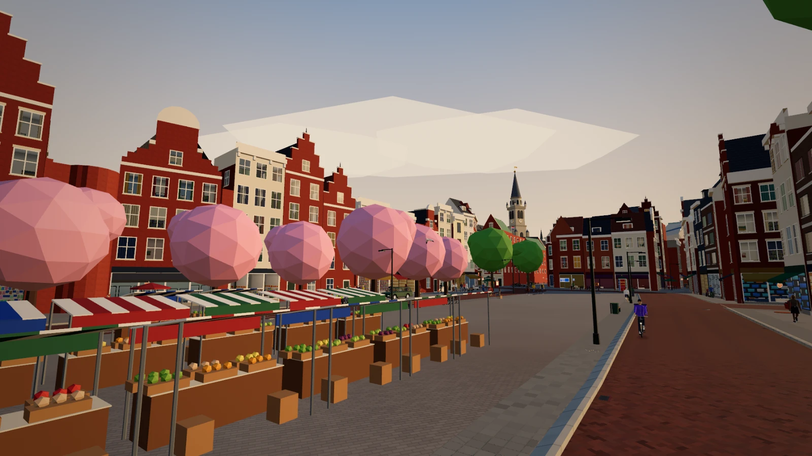

# GDE Groningen – Zomer vol misdaad

**Openbare playtest · gratis · 18+ · geen account**

> **In English, briefly.** *GDE Groningen – Zomer vol misdaad* is a free, open-world
> comedy crime game set in a 3D Groningen built from real OpenStreetMap data. It is a
> **playable public playtest**: the story runs from start to finish, but features are
> still being added, saves may change before 1.0, and every release is an unsigned
> pre-release. The game is **Dutch-only**, for players aged **18+**, and runs on
> Windows, macOS, Linux, Android and in the browser from source. Code is
> GPL-3.0-or-later, the game's own content is CC BY-NC-SA 4.0. This is a fan parody, not
> affiliated with any game publisher.

### [🎮 **Bekijk de marketingpagina en speel mee →**](https://natuspella.github.io/GDE-Groningen/)

Op de marketingpagina vind je de trailer, zes slideshows met locaties en features, de
downloads en de deel-links. De game-webversie is er nog niet; de downloads staan bij de
releases.

## Begin hier

| Waar je naartoe wilt | Waar je moet zijn |
|---|---|
| **Spelen en rondkijken** | [marketingpagina](https://natuspella.github.io/GDE-Groningen/) |
| **Installeren, besturing, samen spelen of een probleem oplossen** | [hulp en veelgestelde vragen](https://natuspella.github.io/GDE-Groningen/help/) |
| **De nieuwste build downloaden** | [releases](../../releases) |
| **Documentatie, architectuur en ontwerp** | [docs/README.md](docs/README.md) |
| **Een bug of wens melden** | [Issues](../../issues) |
| **Bijdragen** | [CONTRIBUTING.md](CONTRIBUTING.md) |

## Status

GDE Groningen is een gratis hobbyproject in ontwikkeling. Het verhaal is helemaal uit te
spelen, maar er komen nog functies en missies bij, er zitten ruwe randen aan en vóór 1.0
kan een savegame nog breken. Elke versie is een pre-release; er is nog geen online versie
van het spel. Het spel is **18+** (geweld, bloed en gokken met spelgeld; zie
[docs/LEEFTIJD.md](docs/LEEFTIJD.md)).

## Downloads

Pak de nieuwste pre-release bij de [releases](../../releases). De builds zijn niet
ondertekend, dus je systeem waarschuwt de eerste keer; wat je dan doet staat op de
[hulppagina over installeren](https://natuspella.github.io/GDE-Groningen/help/installeren.html).

- **Windows** — `GDE-Groningen-<versie>-windows-portable.exe`, geen installatie nodig.
- **macOS** — `GDE-Groningen-<versie>-mac.dmg` voor Apple Silicon en Intel.
- **Linux en Steam Deck** — `GDE-Groningen-<versie>-linux.AppImage` of `.tar.gz`.
- **Android** — `GDE-Groningen-<versie>-android-debug.apk` (debug, om te proberen).

Niet elke release heeft elk platform; kijk in de release zelf wat erbij zit. Vanaf de
broncode bouwen kan ook: zie [docs/ONTWIKKELEN.md](docs/ONTWIKKELEN.md).

## Documentatie, hulp en dit project

- **Marketing:** [marketingpagina](https://natuspella.github.io/GDE-Groningen/),
  [perskit](docs/PERSKIT.md) en [social/website-teksten](docs/SOCIAL-EN-WEBSITE.md).
- **Hulp:** [helpcentrum](https://natuspella.github.io/GDE-Groningen/help/) met
  [installeren](https://natuspella.github.io/GDE-Groningen/help/installeren.html),
  [spelen en besturing](https://natuspella.github.io/GDE-Groningen/help/spelen.html),
  [samen spelen](https://natuspella.github.io/GDE-Groningen/help/samen-spelen.html) en
  [problemen melden](https://natuspella.github.io/GDE-Groningen/help/problemen.html).
- **Documentatie:** [docs/README.md](docs/README.md) is de ingang; de canonieke regels
  staan in [.specs-fire/standards/](.specs-fire/standards/) en de architectuur in
  [ARCHITECTURE.md](ARCHITECTURE.md).
- **Ontwikkeling:** [docs/ONTWIKKELEN.md](docs/ONTWIKKELEN.md),
  [docs/TESTEN.md](docs/TESTEN.md) en de [playtestissues](../../issues).
- **Veiligheid en gedrag:** [SECURITY.md](SECURITY.md) en
  [CODE_OF_CONDUCT.md](CODE_OF_CONDUCT.md).

## Licenties

| Wat | Licentie |
|---|---|
| Programmacode | [GPL-3.0-or-later](LICENSE) |
| Eigen inhoud: stemmen, muziek, verhaal, dialogen, schermafbeeldingen | [CC BY-NC-SA 4.0](LICENSE-CONTENT.md) |
| Naam GDE / "GDE Groningen – Zomer vol misdaad" en het logo | alle rechten voorbehouden |
| Kaartdata en bronnen van derden | zie [NOTICE.md](NOTICE.md) en [docs/LICENTIES.md](docs/LICENTIES.md) |

## Disclaimer

GDE Groningen – Zomer vol misdaad is een gratis, niet-commerciële fanparodie, niet
gelieerd aan, gesponsord door of goedgekeurd door enige andere gameontwikkelaar of
-uitgever. Namen, personages, bedrijven, merken en gebeurtenissen in het spel zijn
verzonnen; gelijkenis met bestaande personen of bedrijven berust op toeval. Echte straten
en openbare gebouwen zijn alleen het decor.

Gemaakt in Groningen door [NatusPella](https://github.com/NatusPella).
