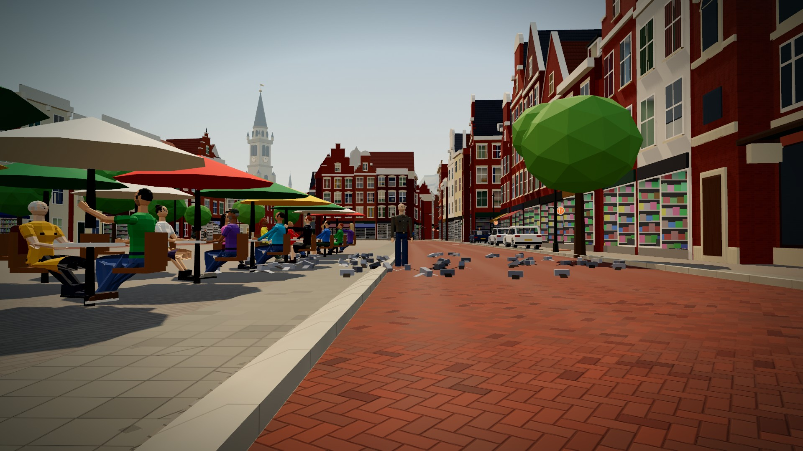
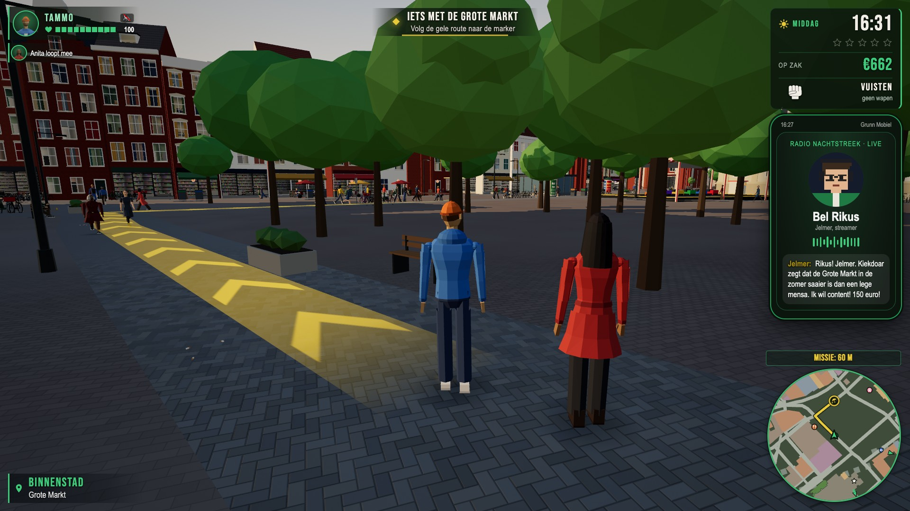
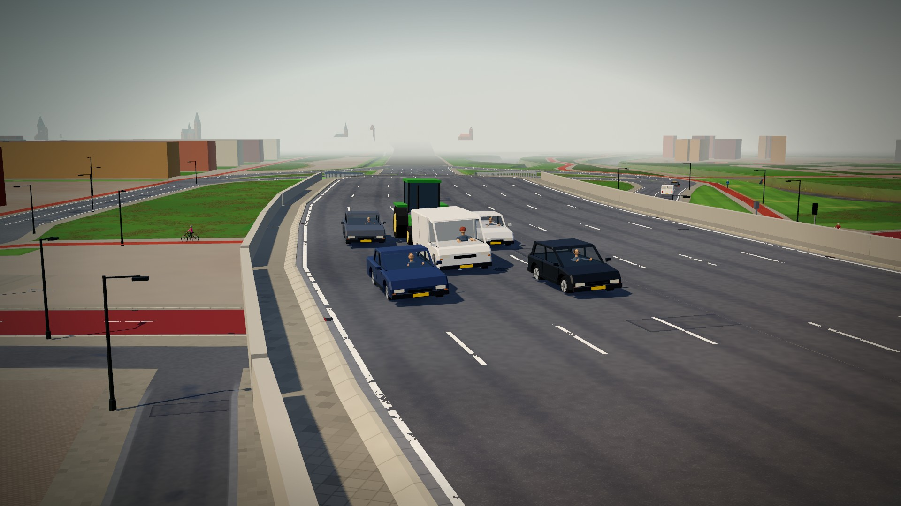
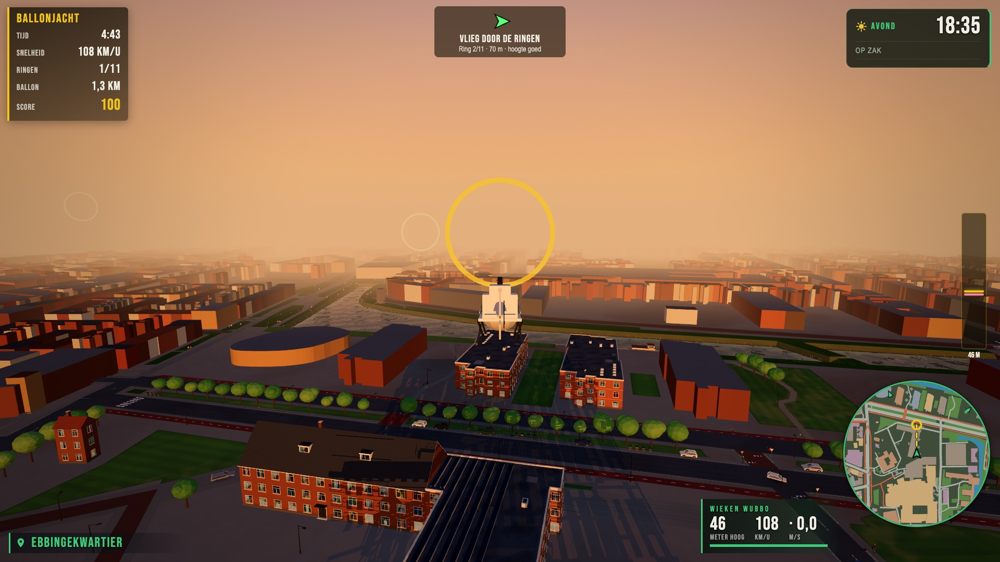
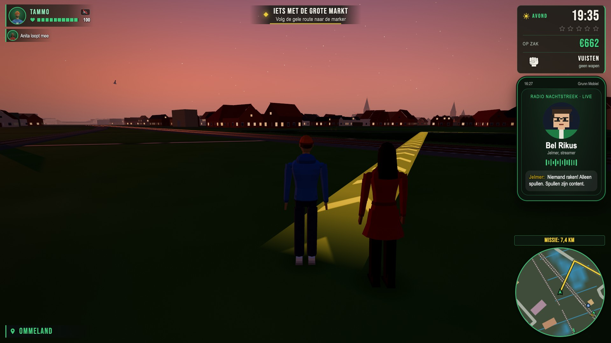
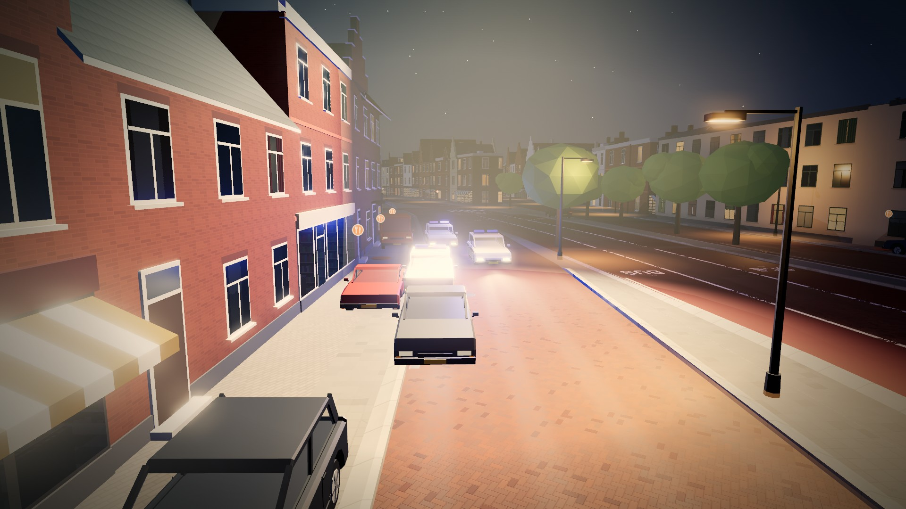
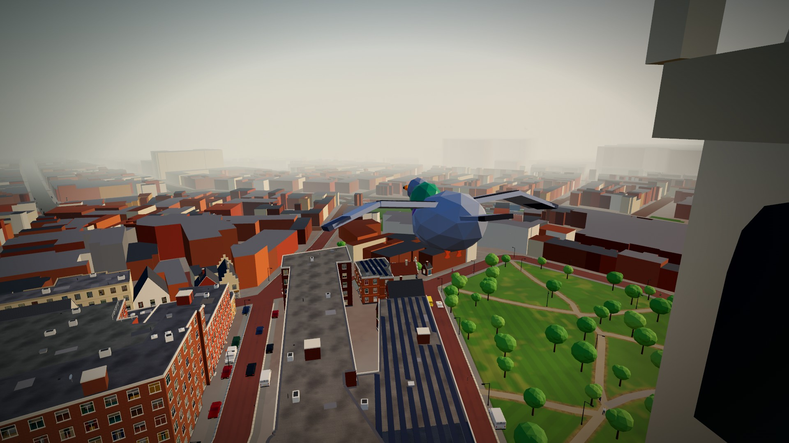

# GDE Groningen – Zomer vol misdaad

> **In English, briefly.** *GDE Groningen – Zomer vol misdaad* ("Biggest
> Heist Ever: Groningen – A Summer of Crime") is a free, open-world comedy
> crime game set in a 3D Groningen built from real OpenStreetMap data. You
> play Tammo and Tessa, two broke locals who get dragged into a heist over
> the city's beloved *eierbal*, in a world full of Gronings humour, voiced
> dialogue (in Gronings dialect) and generated music. The game is
> **Dutch-only** and meant for players aged **18+**. It runs in the browser or as a desktop
> app for macOS, Windows and Linux, built with three.js and Electron. Code
> under GPL-3.0-or-later, the game's own content under CC BY-NC-SA 4.0, the
> name and logo are not free to use (see [Licenties](#licenties)). This is
> a fan parody, not affiliated with any game publisher.

*GDE* staat voor *Grootste Diefstal Ever*. Een open-wereldgame vol
misdaad en flauwekul, in het echte Groningen: de straten, grachten,
gebouwen en het Ommeland komen uit OpenStreetMap.



## Waar gaat het over

Tammo en Tessa hebben geen geld, wel een droom: een eigen frietkraam, de
Fjord Frituur. Dan verdwijnt de Gouden Eierbal uit het museum, en voor
je het weet sta je midden in een zomer vol misdaad, met snackkoning Jelle
Terpstra, de tweeling Durk & Douwe en half Grunn achter je aan.

- **Het echte Groningen**: ~35.000 gebouwen, de Diepenring, de ringweg,
  bruggen, kroegen en landmarks, met daaromheen het Ommeland met echte
  dorpen, wegen en water.
- **Een verhaal met missies**, cutscenes en ingesproken dialogen. Alle
  stemmen praten Gronings, de ondertitels zijn Nederlands.
- **Open wereld**: auto's, fietsen, bussen, boten, een helikopter, politie
  die je achtervolgt, bijbaantjes, winkels, een kermis, een stuntavond, de
  radio en een duif-modus om over de stad te vliegen.
- **Gronings van toon**: droge humor, eierballen, Kiekdoar (de
  nieuwssite in het spel) en Radio Proat.

De game is **18+** (geweld, bloed en gokken met spelgeld; zie
[docs/LEEFTIJD.md](docs/LEEFTIJD.md)).

## Schermafbeeldingen

| | |
|---|---|
|  |  |
|  |  |
|  |  |

Alle beelden zijn in het spel zelf gemaakt (`scripts/steam_images.mjs`);
meer in [docs/steam/beelden/](docs/steam/beelden/).

## Spelen en bouwen

Kort, voor wie net binnenkomt:

- **Spelen**: pak een build bij de [Releases](../../releases) (macOS, Windows,
  soms Linux). Het zijn pre-releases van een spel in ontwikkeling en ze zijn
  niet ondertekend, dus je systeem waarschuwt de eerste keer. Het spel is
  Nederlandstalig, bedoeld voor 18+ en gratis. Er is nog geen online versie.
- **Zelf draaien**: de browserversie start met een kleine lokale server en
  `python3 scripts/devserver.py 8765 game`, de desktopapp met
  `cd desktop && npm install && npm start` (Node.js nodig). Zie hieronder.
- **Bouwen aan het spel**: het spel is gewone JavaScript (ES-modules, three.js),
  de kaart wordt met Python- en Node-scripts uit OpenStreetMap, 3DBAG en AHN
  gemaakt. Begin met [docs/ONTWIKKELEN.md](docs/ONTWIKKELEN.md) en
  [ARCHITECTURE.md](ARCHITECTURE.md). De kaarttegels (`game/world/`) staan
  niet in git en worden bij het klaarzetten gemaakt (`npm run stage`).
- **Meedoen**: lees [CONTRIBUTING.md](CONTRIBUTING.md). Alle speltekst is
  Nederlands, en er komen geen echte merken, bedrijven of personen in. De
  namen die wel in het spel staan zijn verzonnen; zie het
  [merkenregister](docs/MERKENREGISTER.md).
- **Rechten**: code onder GPL-3.0-or-later, eigen inhoud onder CC BY-NC-SA 4.0,
  naam en logo voorbehouden (zie [Licenties](#licenties)). Muziek en stemmen
  zijn met AI gemaakt; alleen de geluidseffecten worden in het spel zelf
  gesynthetiseerd.

## Downloaden en installeren

De builds staan bij de [Releases](../../releases) van deze repo, per versie:

| Systeem | Bestand |
|---|---|
| macOS (Apple Silicon en Intel) | `GDE-Groningen-<versie>-mac.dmg` |
| Windows (64-bit) | `GDE-Groningen-<versie>-windows-portable.exe` |
| Linux en Steam Deck (x64) | `GDE-Groningen-<versie>-linux.AppImage` of `.tar.gz` (niet bij elke versie) |

> **Let op: de builds zijn niet ondertekend.** GDE Groningen is een gratis
> hobbyproject zonder betaalde certificaten van Apple of Microsoft. Daarom
> waarschuwt je systeem de eerste keer.

- **macOS**: open de `.dmg` en sleep GDE Groningen naar Programma's. Start de
  app; bij de melding klik je **Gereed**. Ga dan naar **Systeeminstellingen ›
  Privacy en beveiliging** en klik onderaan op **Open toch**. Daarna start
  hij gewoon.
- **Windows**: dubbelklik op de `.exe`, installeren is niet nodig. Zegt
  Windows "Windows heeft uw pc beveiligd"? Klik op **Meer info** en dan op
  **Toch uitvoeren**.
- **Linux**: maak de AppImage uitvoerbaar (`chmod +x GDE-Groningen-*.AppImage`
  of via Eigenschappen › Uitvoerbaar) en start hem. Of pak de `.tar.gz` uit
  en start `gde-groningen`. Op de Steam Deck: download in de
  bureaubladmodus en voeg hem toe met **Aan Steam toevoegen**.

### Savegames en privacy

Het spel slaat vanzelf op (en met **Opslaan** in het menu), op je eigen
apparaat. Vanaf versie 1.0 blijft een savegame werken in elke latere versie:
oudere savegames worden bij het laden bijgewerkt (`game/js/savemigrate.js`).
Een savegame van het oude verhaal (dat niet meer bestaat) gaat door in het nieuwe verhaal: geld, spullen, voertuigen, prestaties en instellingen blijven, het verhaal begint opnieuw. Je oude savegame blijft ongemoeid op je apparaat staan.

Er is geen account, geen tracking en geen statistiek; de desktopapp
gebruikt geen internet. Fouten komen in een logboek op je eigen apparaat
(**Instellingen › Foutrapport**) dat nergens heen gaat: je kunt het zelf
kopiëren als je een bug meldt.

## Spelen in de browser of vanaf de broncode

Er staat (nog) geen online versie. Je kunt de game wel zelf in je browser
draaien. Nodig: [Python 3](https://www.python.org/) en een recente Chrome,
Edge of Firefox (met hardwareversnelling aan).

```bash
git clone https://github.com/NatusPella/GDE-Groningen.git
cd GDE-Groningen
python3 scripts/devserver.py 8765 game
```

Open daarna <http://localhost:8765>. In de browser haalt de game three.js
op bij jsDelivr en de lettertypen bij Google Fonts.

**Windows zonder terminal**: dubbelklik op `start.bat`. Die start een kleine server van Windows zelf (PowerShell, geen Python of Node nodig) op de webbuild in `web-dist` en opent de game in je browser. Speler-zip: `node scripts/make_player_zip.mjs`.

**De desktopapp vanaf de broncode** (nodig: [Node.js](https://nodejs.org/)):

```bash
cd desktop
npm install
npm start          # zet de game klaar (npm run stage) en start Electron
```

Zelf builds, de webversie of een release maken: zie
[docs/ONTWIKKELEN.md](docs/ONTWIKKELEN.md).

## Besturing

| Toets | Lopend | In een voertuig |
|---|---|---|
| W A S D of pijltjes | lopen (Shift: rennen) | gas, achteruit, sturen |
| Spatie | springen | remmen |
| Ctrl | bukken | |
| E of F | instappen, winkel of klus gebruiken | uitstappen |
| Muis | camera draaien | camera draaien |
| Linkermuisknop | aanvallen of schieten | uit het raam schieten |
| Rechtermuisknop | richten | |
| 1 – 4, muiswiel | wapen kiezen | |
| H / L / Q | | toeter / lichten en sirene / achterom kijken |
| M | kaart (klik: route zetten) | kaart |
| Esc | menu met telefoon, spullen en instellingen | |

Een controller (Xbox, PlayStation, Steam Deck) werkt ook, in het spel en in
de menu's. Toetsen en knoppen zijn aan te passen onder **Instellingen ›
Besturing**. Onder **Instellingen › Toegankelijk** vind je de grootte van
de ondertitels, kleurenblindmodi, de grootte van de interface en "Beweging
beperken". Het volledige overzicht staat in
[docs/ONTWIKKELEN.md](docs/ONTWIKKELEN.md#controls) en in het spel zelf.

## Hoe het gemaakt is

| Onderdeel | Waarmee |
|---|---|
| 3D en spel | [three.js](https://threejs.org/) r160, gewone JavaScript ES-modules, geen bundler en geen npm-pakketten in het spel |
| Desktopapp | [Electron](https://www.electronjs.org/), gebouwd met electron-builder, volledig offline |
| Kaart | [OpenStreetMap](https://www.openstreetmap.org/) via Overpass, omgezet met de Python-scripts in `scripts/` |
| Stemmen | Google Gemini TTS (via OpenRouter), ingesproken in het Gronings; per map vastgelegd in `tts.json` |
| Muziek | gemaakt met Google Gemini |
| Geluidseffecten, texturen, modellen | in de code zelf gemaakt (procedureel); de Martinitoren is gemodelleerd met Claude Design |

### Mappen

| Map | Wat |
|---|---|
| `game/` | de game zelf: `index.html`, `js/` (alle modules), `audio/`, `models/` en de kaartbestanden |
| `desktop/` | de Electron-app, het klaarzetten (`build.mjs`) en het releasescript |
| `web/` | de losse webversie (Opus-audio, service worker) |
| `scripts/` | kaart bouwen, stemmen opnemen, tests en meetscripts |
| `data/` | OpenStreetMap-extracten waar de kaart uit gebouwd wordt |
| `docs/` | ontwerp, verhaal, licenties, publicatie en meer |
| `steam/` | sjablonen voor een eventuele Steam-build |

Hoe de modules samenwerken staat in [ARCHITECTURE.md](ARCHITECTURE.md), de
beeldstijl in [DESIGN_SYSTEM.md](DESIGN_SYSTEM.md), de plannen in
[GitHub-bord](https://github.com/users/NatusPella/projects/5) (bugs en wensen, als issues) en wat er per versie veranderde in
[CHANGELOG.md](CHANGELOG.md).

## Meedoen

Bijdragen zijn welkom: meld een bug of idee via de
[Issues](../../issues), of stuur een pull request. Lees eerst
[CONTRIBUTING.md](CONTRIBUTING.md). In het kort:

- Alle tekst in het spel is Nederlands (en de stemmen Gronings).
- Geen echte merken, bedrijven of personen; verzin een eigen naam.
- Sluit aan bij de stijl van de code eromheen, en draai de tests
  (`node scripts/save_migration_test.mjs` en de andere `scripts/*_test.mjs`).
- Bijdragen vallen onder dezelfde licenties als het project.

Zie ook de [gedragscode](CODE_OF_CONDUCT.md) en, voor beveiligingsproblemen,
[SECURITY.md](SECURITY.md).

## Licenties

| Wat | Licentie |
|---|---|
| De programmacode | [GPL-3.0-or-later](LICENSE) |
| Eigen inhoud: stemmen, muziek, verhaal en dialogen, het Martinitoren-model, schermafbeeldingen | [CC BY-NC-SA 4.0](LICENSE-CONTENT.md) |
| De naam GDE / "GDE Groningen – Zomer vol misdaad" en het logo | alle rechten voorbehouden: een fork krijgt een eigen naam en logo |
| Kaartdata (`game/citymap.json`, `game/mapextras.json`, de kaarttegels, `data/`) | © OpenStreetMap-bijdragers, [Open Database License](https://www.openstreetmap.org/copyright) |
| three.js | MIT ([licenses/MIT-three.js.txt](licenses/MIT-three.js.txt)) |
| Lettertypen Bebas Neue en Big Shoulders Display | SIL Open Font License 1.1 ([licenses/](licenses/)) |
| Electron (alleen de desktopapp) | MIT, met Chromium en Node.js onder hun eigen licenties |

De precieze indeling per map staat in [LICENSE-CONTENT.md](LICENSE-CONTENT.md),
alle vermeldingen van werk van anderen in [NOTICE.md](NOTICE.md) en de
achtergrond in [docs/LICENTIES.md](docs/LICENTIES.md). Muziek en stemmen
zijn gemaakt met AI (Google Gemini).

## Disclaimer

GDE Groningen is een gratis, niet-commercieel fanproject en een parodie.
Het is niet gelieerd aan, gesponsord door of goedgekeurd door een
gameontwikkelaar of -uitgever. Namen, personages, bedrijven, merken en
gebeurtenissen in het spel zijn verzonnen; echte straten en openbare
gebouwen zijn alleen het decor.

Gemaakt in Groningen door [NatusPella](https://github.com/NatusPella).
