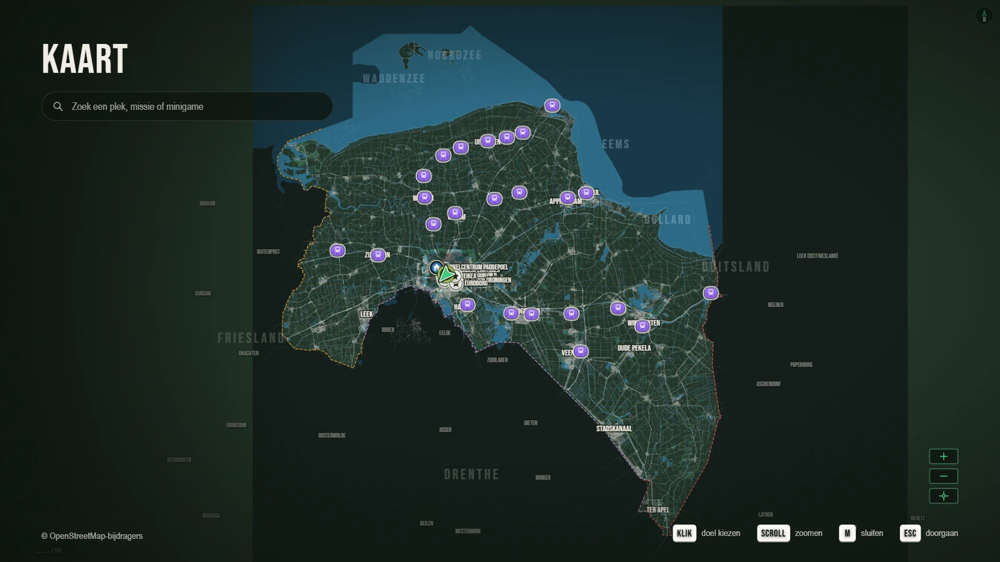
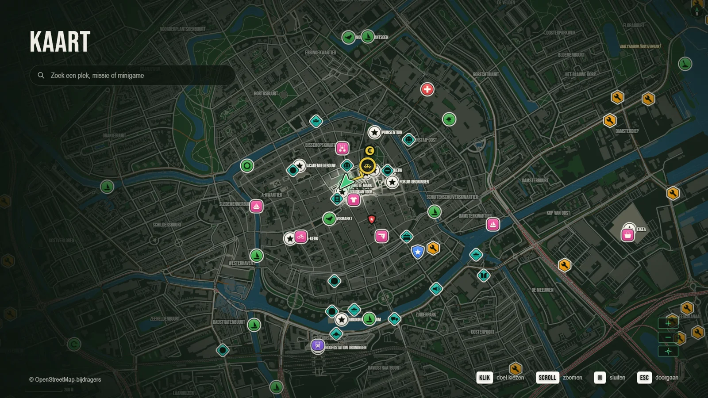
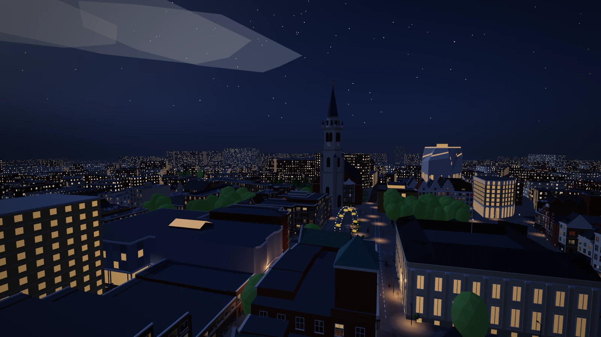
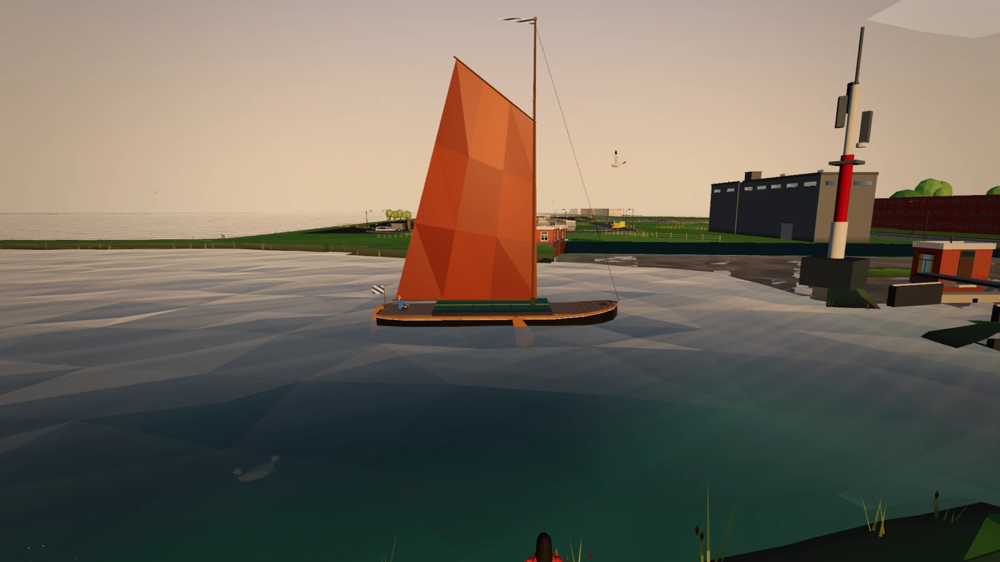
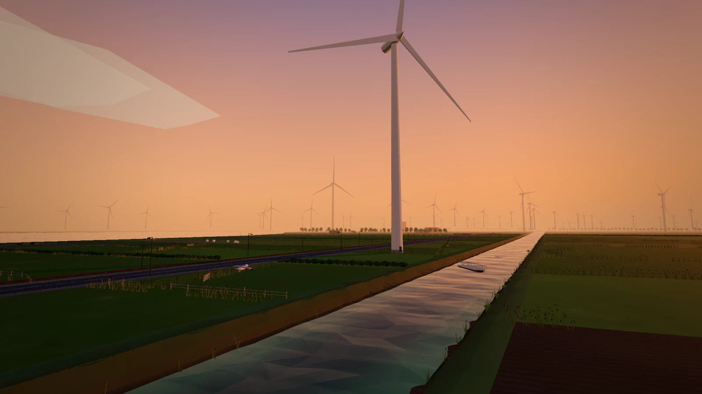
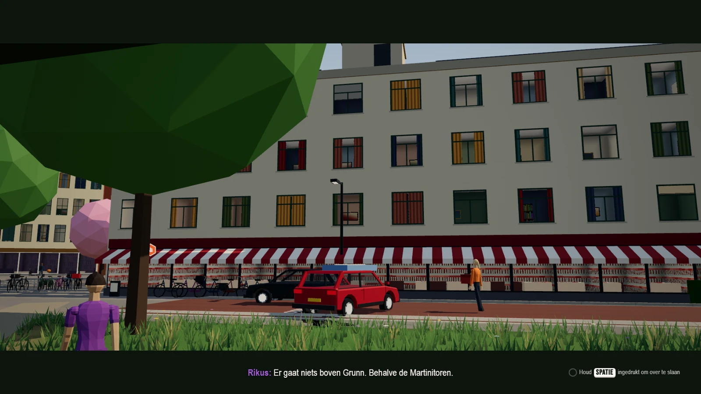
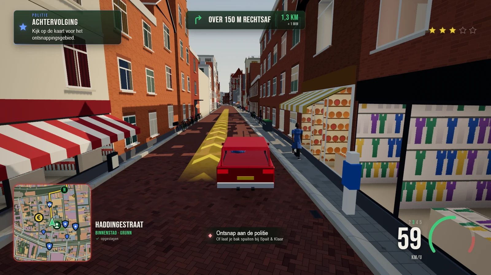
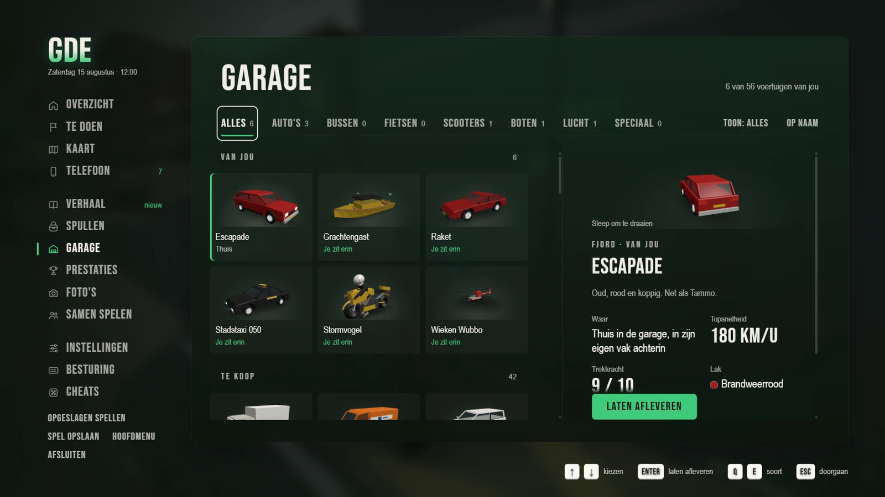
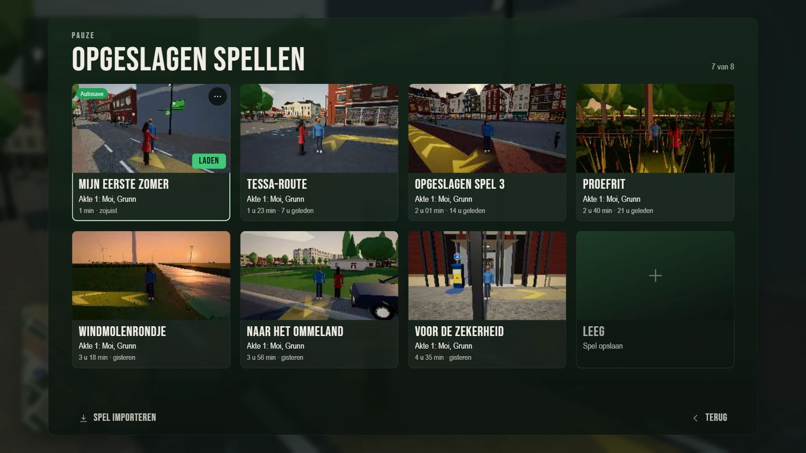
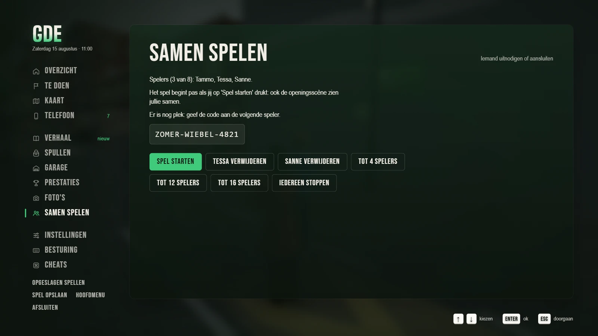

# GDE Groningen – Zomer vol misdaad

**Status: openbare playtest (november 2026).** Het verhaal is van de opening tot de
epiloog uit te spelen, maar het spel is nog niet af: er komen functies en missies bij,
menu's en besturing worden bijgeschaafd en vóór 1.0 kan een savegame nog breken. Elke
versie is een pre-release; dit is geen Early Access en er is geen winkelversie. Zie
[Status](#status-openbare-playtest) en [Feedback geven](#feedback-geven).

> **In English, briefly.** *GDE Groningen – Zomer vol misdaad* ("Biggest Heist Ever:
> Groningen – A Summer of Crime") is a free, open-world comedy crime game set in a 3D
> Groningen built from real OpenStreetMap data. You play Tammo and Tessa, two broke
> locals who get dragged into a heist over the city's beloved *eierbal*, in a world
> full of Gronings humour, voiced dialogue (mostly Gronings, with Dutch and other
> accents) and generated music. It is an **open public playtest**: the story can be
> played from start to finish, but features are still being added, rough edges remain,
> saves may change before 1.0, and every release is an unsigned pre-release — there is
> no Early Access and no store version. The game is **Dutch-only**, meant for players
> aged **18+**, and runs in the browser or as a desktop app for macOS, Windows and
> Linux. Code is under GPL-3.0-or-later, the game's own content under CC BY-NC-SA 4.0,
> the name and logo are not free to use (see [Licenties](#licenties)). Feedback is
> welcome via the [Issues](../../issues). This is a fan parody, not affiliated with
> any game publisher.

*GDE* staat voor *Grootste Diefstal Ever*. Een open-wereldgame vol
misdaad en flauwekul, in het echte Groningen: de straten, grachten,
gebouwen en het Ommeland komen uit OpenStreetMap.


## Status: openbare playtest

GDE Groningen is een gratis hobbyproject in ontwikkeling. Deze fase heet
**openbare playtest**: geen winkel, geen prijs en geen betaalde versie, alleen
pre-releases op GitHub en deze broncode. Dat is dus ook geen Early Access.
Dat betekent:

- **Het verhaal is helemaal uit te spelen**, van de opening tot de epiloog,
  en de open wereld met de stad en de provincie eromheen werkt. Grote delen
  zijn nog niet door menselijke spelers getest.
- **Er komt nog van alles bij en er gaat nog wat mis.** Missies, activiteiten,
  prestaties en menu's worden aangevuld en bijgeschaafd; verwacht ruwe randen.
- **Savegames zijn vóór 1.0 nog niet gegarandeerd.** Tussen versies kan een
  savegame breken; vanaf 1.0 blijft een save werken in elke latere versie.
  Bewaar je oude saves als je een nieuwe versie uitprobeert.
- **De builds zijn pre-releases en niet ondertekend.** Je systeem waarschuwt
  de eerste keer; dat is normaal voor een hobbyproject zonder dure
  certificaten.
- **Niet elke release heeft alle platformen.** Windows bouwt lokaal, macOS,
  Linux en Android via GitHub Actions; als de gratis Actions-minuten op zijn,
  verschijnen die builds later (zie [Downloaden en installeren](#downloaden-en-installeren)).
- **Er is nog geen online versie.** De webversie draai je zelf vanaf de
  broncode; een publieke webversie is een aparte stap.

Dit is een playtest: bugs, klachten en ideeën zijn juist nu welkom. Zie
[Feedback geven](#feedback-geven).

## Waar gaat het over

Tammo en Tessa hebben geen geld, wel een droom: een eigen frietkraam, de
Fjord Frituur. Dan verdwijnt de Gouden Eierbal uit het museum, en voor
je het weet sta je midden in een zomer vol misdaad, met snackkoning Jelle
Terpstra, de tweeling Durk & Douwe en half Grunn achter je aan.

- **Het echte Groningen**: ~50.000 gebouwen in de stad, de Diepenring, de
  ringweg, bruggen, kroegen en landmarks, met daaromheen het Ommeland met
  echte dorpen, wegen en water; over de hele kaart honderdduizenden gebouwen.
- **Een verhaal met missies**, cutscenes en ingesproken dialogen. De meeste
  stemmen praten Gronings; Tessa en een paar figuranten praten Nederlands,
  Fries, Duits of Engels. De ondertitels zijn Nederlands.
- **Open wereld**: auto's, fietsen, bussen, boten, een helikopter, politie
  die je achtervolgt, bijbaantjes, winkels, een kermis, een stuntavond, de
  radio en een duif-modus om over de stad te vliegen.
- **Gronings van toon**: droge humor, eierballen, Kiekdoar (de
  nieuwssite in het spel) en Radio Proat.
- **Samen spelen**: nodig een vriend uit met een kamercode; die speelt Tessa
  of kiest een eigen figuur. Geen account nodig.

De game is **18+** (geweld, bloed en gokken met spelgeld; zie
[docs/LEEFTIJD.md](docs/LEEFTIJD.md)).

## Schermafbeeldingen

| | |
|---|---|
| <br>**De hele provincie** op de kaart (M): dorpen, wegen, water en stations, met de Waddenzee boven en Drenthe en Duitsland aan de randen. | <br>**De stad op de kaart**: elke plek heeft een eigen icoon, van winkels en garages tot klussen en bijzondere plekken. |
| <br>**Groningen bij nacht**: de Martinitoren boven een zee van verlichte ramen. | <br>**Aan de Waddenzee**: een skutsje bij de sluis, in het licht van een lange zomeravond. |
| <br>**Het Ommeland**: windturbines, kanalen en weidse luchten bij de Eemshaven. | <br>**De opening**: de meeste stemmen praten Gronings, de ondertitel is gewoon Nederlands. |
| <br>**Achtervolging**: drie sterren, de politie zoekt je en jij zoekt een steegje. | <br>**De garage**: auto's, boten, scooters en een helikopter, elk met een draaiend 3D-voorbeeld. |
| <br>**Opgeslagen spellen**: tot acht spelstanden, elk met een eigen miniatuur, naam en speeltijd. | <br>**Samen spelen**: nodig vrienden uit met een kamercode; wie meedoet speelt Tessa of kiest een eigen figuur. |

Alle beelden zijn in het spel zelf gemaakt, op 1920x1080 met de voorinstelling Hoog (`scripts/qa/readme_shots.mjs`, zie [docs/TESTEN.md](docs/TESTEN.md)); meer, voor een eventuele Steam-pagina, in [docs/steam/beelden/](docs/steam/beelden/).

## Spelen en bouwen

Kort, voor wie net binnenkomt:

- **Spelen**: pak de nieuwste pre-release bij de [Releases](../../releases).
  Dat zijn pre-releases van de openbare playtest en ze zijn niet ondertekend,
  dus je systeem waarschuwt de eerste keer. Gratis, Nederlandstalig, 18+.
  Kijk in de release zelf welke platformen erbij zitten; in november 2026
  stonden de macOS-, Linux- en Android-builds nog op een oudere versie
  (v0.60.0) en hadden de nieuwste releases alleen de Windows-versie plus de
  wereld. Er is nog geen online versie.
- **Zelf draaien**: de browserversie start met een kleine lokale server en
  `python3 scripts/devserver.py 8765 game`, de desktopapp met
  `cd desktop && npm install && npm start` (Node.js nodig). Een verse kloon
  heeft eerst een wereld nodig: zie hieronder. 
- **Bouwen aan het spel**: het spel is gewone JavaScript (ES-modules, three.js),
  de kaart wordt met Node- en Python-scripts uit OpenStreetMap, 3DBAG en AHN
  gemaakt. Begin met [docs/ONTWIKKELEN.md](docs/ONTWIKKELEN.md) en
  [ARCHITECTURE.md](ARCHITECTURE.md). De kaarttegels (`game/world/`) staan
  niet in git en worden bij `cd desktop && npm run stage` in
  `desktop/build/game/world/` gezet.
- **Meedoen**: lees [CONTRIBUTING.md](CONTRIBUTING.md). Alle speltekst is
  Nederlands, en er komen geen echte merken, bedrijven of personen in. De
  namen die wel in het spel staan zijn verzonnen; zie het
  [merkenregister](docs/MERKENREGISTER.md).
- **Rechten**: code onder GPL-3.0-or-later, eigen inhoud onder CC BY-NC-SA 4.0,
  naam en logo voorbehouden (zie [Licenties](#licenties)). Muziek en stemmen
  zijn met AI gemaakt; de geluidseffecten worden grotendeels in het spel zelf
  gesynthetiseerd, aangevuld met een paar CC0-opnames van Freesound.

## Downloaden en installeren

De builds staan bij de [Releases](../../releases) van deze repo, per versie.
Elke release is een pre-release van de openbare playtest. Niet elke versie heeft
elk platform: Windows wordt lokaal gebouwd, macOS, Linux en Android via GitHub
Actions; als de gratis Actions-minuten van de maand op zijn, volgen die builds
later of bij een volgende release. Kijk dus in de release zelf wat erin zit.

| Systeem | Bestand |
|---|---|
| macOS (Apple Silicon en Intel) | `GDE-Groningen-<versie>-mac.dmg` (niet bij elke versie) |
| Windows (64-bit) | `GDE-Groningen-<versie>-windows-portable.exe` |
| Linux en Steam Deck (x64) | `GDE-Groningen-<versie>-linux.AppImage` of `.tar.gz` (niet bij elke versie) |
| Android | `GDE-Groningen-<versie>-android-debug.apk` (debug, niet bij elke versie) |

> **Let op: de builds zijn niet ondertekend.** GDE Groningen is een gratis
> hobbyproject zonder betaalde certificaten van Apple of Microsoft. Daarom
> waarschuwt je systeem de eerste keer.

- **macOS**: open de `.dmg` en sleep GDE Groningen naar Programma's. Start de
  app; bij de melding klik je **Gereed**. Ga dan naar **Systeeminstellingen ›
  Privacy en beveiliging** en klik onderaan op **Open toch**. Daarna start
  hij gewoon.
- **Windows**: dubbelklik op de `.exe`, installeren is niet nodig. Zegt
  Windows "Windows heeft uw pc beveiligd"? Klik op **Meer info** en dan op
  **Toch uitvoeren**.
- **Linux**: maak de AppImage uitvoerbaar (`chmod +x GDE-Groningen-*.AppImage`
  of via Eigenschappen › Uitvoerbaar) en start hem. Of pak de `.tar.gz` uit
  en start `gde-groningen`. Op de Steam Deck: download in de
  bureaubladmodus en voeg hem toe met **Aan Steam toevoegen**.

Naast de Windows-build staan meestal `gde-world.tgz` en `SHA256SUMS.txt` in de
release; met dat laatste bestand kun je controleren of je download compleet is.
Die `gde-world.tgz` heb je ook nodig als je vanaf de broncode bouwt.

### Opgeslagen spellen en privacy

Het spel slaat vanzelf op (en met **Opslaan** in het menu), op je eigen
apparaat. Bij het starten gaat het verder met de save die je het laatst hebt opgeslagen; een ander opgeslagen spel of een **Nieuw spel** kies je in het pauzemenu onder **Spel**. Vanaf versie 1.0 blijft een savegame werken in elke latere versie:
oudere savegames worden bij het laden bijgewerkt (`game/js/savemigrate.js`).
Vóór 1.0 kan een savegame bij een update nog breken: bewaar je oude saves als
je een nieuwe versie probeert. Een savegame van het oude verhaal (dat niet meer bestaat) gaat door in het nieuwe verhaal: geld, spullen, voertuigen, prestaties en instellingen blijven, het verhaal begint opnieuw. Je oude savegame blijft ongemoeid op je apparaat staan.

Er is geen account, geen tracking en geen statistiek, en de desktopapp speelt
offline. Er zijn twee uitzonderingen, en die kun je zelf uitzetten:
(1) **Samen spelen** — na je toestemming gaat je IP-adres naar een openbare
STUN-server en lopen de versleutelde signaleringsberichten via openbare
brokers; (2) **live busposities**, die standaard aan staan — een openbare
leesopvraag zonder gegevens van jou, met een uitzetter in het pauzemenu onder
**Spel › Spelen**. Zonder die twee gaat er vanuit de desktopapp niets van of
over jou naar buiten; zie [docs/PRIVACY-EN-CREDITS.md](docs/PRIVACY-EN-CREDITS.md).
Speel je in de browser vanaf de broncode, dan haalt de pagina three.js en de
lettertypen bij jsDelivr en Google Fonts; de zelfgebouwde webversie draagt
alles zelf mee.
Fouten komen in een logboek op je eigen apparaat (**Over › Problemen**, met
**Kopieer het rapport**) dat nergens heen gaat: je kunt het zelf plakken als je
een bug meldt.

## Spelen in de browser of vanaf de broncode

Er staat (nog) geen online versie. Je kunt de game wel zelf in je browser
draaien. Nodig: [Python 3](https://www.python.org/) en een recente Chrome,
Edge of Firefox (met hardwareversnelling aan).

```bash
git clone https://github.com/NatusPella/GDE-Groningen.git
cd GDE-Groningen
python3 scripts/devserver.py 8765 game
```

Open daarna <http://localhost:8765>. Let op: zonder gebouwde wereld in
`game/world/` (die staat niet in git) zie je alleen de basiskaart met wegen en
spoor, niet de OSM-gebouwen en de provincie. Haal dan `gde-world.tgz` uit een
release, pak hem uit en zet `GDE_PREBUILT_WORLD` op die map bij het bouwen
(zie [docs/ONTWIKKELEN.md](docs/ONTWIKKELEN.md)).

**Windows zonder terminal**: dubbelklik op `start.bat`. Die start een kleine
server van Windows zelf (PowerShell, geen Python of Node nodig) op de webbuild
in `web-dist` en opent de game in je browser. `web-dist` staat niet in git:
maak hem eerst met `node web/build.mjs` (met een gebouwde wereld) of gebruik de
speler-zip (`node scripts/make_player_zip.mjs`).

**De desktopapp vanaf de broncode** (nodig: [Node.js](https://nodejs.org/)):

```bash
cd desktop
npm install
npm run stage      # zet de game en de wereld klaar in desktop/build/
npm start
```

Een verse kloon heeft geen `data/cache/province`; zonder die cache heb je
`gde-world.tgz` uit een release nodig (uitpakken en `GDE_PREBUILT_WORLD` op die
map zetten). Zie [docs/ONTWIKKELEN.md](docs/ONTWIKKELEN.md).

Zelf builds, de webversie of een release maken: zie
[docs/ONTWIKKELEN.md](docs/ONTWIKKELEN.md). De volledige repo met geschiedenis
is groot (honderden megabytes); voor alleen spelen is een release de snelste weg.

## Besturing

| Toets | Lopend | In een voertuig |
|---|---|---|
| W A S D of pijltjes | lopen (Shift: rennen) | gas, achteruit, sturen |
| Spatie | springen | remmen |
| Ctrl (browser: C) | bukken | |
| E of F | instappen, winkel of klus gebruiken | uitstappen |
| Muis | camera draaien | camera draaien |
| Linkermuisknop | aanvallen of schieten | uit het raam schieten |
| Rechtermuisknop | richten | |
| 1 – 4, muiswiel | wapen kiezen | |
| H / L / Q | | toeter / lichten en sirene / achterom kijken |
| M | kaart (klik: route zetten) | kaart |
| Esc | menu met telefoon, spullen en instellingen | |

Een controller (Xbox, PlayStation, Steam Deck) werkt ook, in het spel en in
de menu's. Toetsen en knoppen zijn aan te passen onder **Instellingen ›
Besturing**. Onder **Instellingen › Toegankelijkheid** vind je kleurenblindmodi,
de grootte van de interface en "Beweging beperken"; de grootte van de
ondertitels staat onder **Geluid & ondertitels**. Het volledige overzicht staat in
[docs/ONTWIKKELEN.md](docs/ONTWIKKELEN.md#controls) en in het spel zelf.

## Feedback geven

Dit is een publieke playtest; jouw ervaring telt. Zo werkt het:

- **Bug of wens**: open een issue via de [Issues](../../issues). Noem de
  versie (staat op het startscherm en in de release), je platform en wat je
  aan het doen was.
- **Foutmelding**: **Over › Problemen › Kopieer het rapport** en plak het
  rapport in het issue. Het logboek blijft op je eigen apparaat.
- **Algemene indruk of playtestverslag**: reageer onder het playtest-issue
  [#116](../../issues/116). Het draaiboek met de scenario's staat in
  [docs/PLAYTESTPLAN.md](docs/PLAYTESTPLAN.md).
- **Geen echte namen of persoonsgegevens** in issues, screenshots of
  opnamen; gebruik een tester-nummer of een beschrijving van de plek.
- **Liever geen spoilers** in openbare issues: beschrijf de missie of plek,
  niet het einde.

## Hoe het gemaakt is

| Onderdeel | Waarmee |
|---|---|
| 3D en spel | [three.js](https://threejs.org/) r160, gewone JavaScript ES-modules, geen bundler en geen npm-pakketten in het spel |
| Desktopapp | [Electron](https://www.electronjs.org/), gebouwd met electron-builder; speelt offline, behalve de twee optionele uitzonderingen hierboven |
| Kaart | [OpenStreetMap](https://www.openstreetmap.org/) via Overpass, met Node gebouwd (`scripts/world/`) en met Python opgehaald (OSM, 3DBAG, AHN) |
| Stemmen | Google Gemini TTS via de LiteLLM-gateway van de eigenaar (nieuwe clips; oude clips zijn via OpenRouter gemaakt), ingesproken in het Gronings en Nederlands; per map vastgelegd in `tts.json` |
| Muziek | gemaakt met Google Gemini |
| Geluidseffecten, texturen, modellen | in de code zelf gemaakt (procedureel); de Martinitoren is gemodelleerd met Claude Design |
| AI-assistenten | Claude (Sonnet 5.5 en Opus 5.5), OpenHands, chat1/agent en DeepSeek V4.1 Flash via DeepSeek Harness hielpen bij code, tests, review en documentatie; in de credits staan zij niet als makers maar als tech-stack. Zie [docs/CREDITS.md](docs/CREDITS.md) |

### Mappen

| Map | Wat |
|---|---|
| `game/` | de game zelf: `index.html`, `js/` (alle modules), `audio/`, `models/` en de kaartbestanden |
| `desktop/` | de Electron-app, het klaarzetten (`build.mjs`) en het releasescript |
| `web/` | de losse webversie (Opus-audio, service worker) |
| `website/` | de marketingpagina voor GitHub Pages (nog niet geactiveerd) |
| `scripts/` | kaart bouwen, stemmen opnemen, tests en meetscripts |
| `data/` | OSM-extracten en hulpbronnen waar de kaart uit gebouwd wordt (3DBAG, AHN); de zware cache staat niet in git |
| `docs/` | ontwerp, verhaal, licenties, publicatie en meer |
| `.specs-fire/` | de specs per systeem (`.specs-fire/standards/`) en het papieren spoor van het werk |
| `steam/` | sjablonen voor een eventuele Steam-build |

In `docs/` staan ook interne ontwerpdocumenten, waaronder het verhaal en de
scènes: **dat bevat spoilers**.

Hoe de modules samenwerken staat in [ARCHITECTURE.md](ARCHITECTURE.md), de
spelregels per systeem in [.specs-fire/standards/](.specs-fire/standards/) (begin
bij [docs/SPECS-FIRE.md](docs/SPECS-FIRE.md)), de
beeldstijl in [DESIGN_SYSTEM.md](DESIGN_SYSTEM.md), de plannen in de
[Issues](../../issues) (bugs en wensen) en wat er per versie
veranderde in [CHANGELOG.md](CHANGELOG.md).

## Meedoen

Deze repo is openbaar en bijdragen zijn welkom: meld een bug of idee via de
[Issues](../../issues), of stuur een pull request. Lees eerst
[CONTRIBUTING.md](CONTRIBUTING.md). In het kort:

- Alle tekst in het spel is Nederlands (en de stemmen Gronings, Nederlands of
  een enkele buitenlandse figurant).
- Geen echte merken, bedrijven of personen; verzin een eigen naam.
- Sluit aan bij de stijl van de code eromheen, en draai de lichte tests
  (`node scripts/test_all.mjs --fase=licht`) voordat je een pull request
  opent.
- Bijdragen vallen onder dezelfde licenties als het project.

Zie ook de [gedragscode](CODE_OF_CONDUCT.md), de [credits](docs/CREDITS.md)
voor iedereen die meehielp, en, voor beveiligingsproblemen,
[SECURITY.md](SECURITY.md). Voor de pers staat een perskit klaar in
[docs/PERSKIT.md](docs/PERSKIT.md).

## Licenties

| Wat | Licentie |
|---|---|
| De programmacode | [GPL-3.0-or-later](LICENSE) |
| Eigen inhoud: stemmen, muziek, verhaal en dialogen, het Martinitoren-model, schermafbeeldingen | [CC BY-NC-SA 4.0](LICENSE-CONTENT.md) |
| De naam GDE / "GDE Groningen – Zomer vol misdaad" en het logo | alle rechten voorbehouden: een fork krijgt een eigen naam en logo |
| OpenStreetMap-extracten en kaartdata (`game/stad.json`, `game/mapextras.json`, de kaarttegels, OSM-data in `data/`) | © OpenStreetMap-bijdragers, [Open Database License](https://www.openstreetmap.org/copyright) |
| 3DBAG-gebouwhoogtes, AHN-terrein, gemeente- en wijkgrenzen (Kadaster/CBS) in `data/` | CC BY 4.0, CC0 en Public Domain Mark: zie [NOTICE.md](NOTICE.md) |
| three.js | MIT ([licenses/MIT-three.js.txt](licenses/MIT-three.js.txt)) |
| Lettertypen Bebas Neue en Big Shoulders Display | SIL Open Font License 1.1 ([licenses/](licenses/)) |
| Electron (alleen de desktopapp) | MIT, met Chromium en Node.js onder hun eigen licenties |

De precieze indeling per map staat in [LICENSE-CONTENT.md](LICENSE-CONTENT.md),
alle vermeldingen van werk van anderen in [NOTICE.md](NOTICE.md) en de
achtergrond in [docs/LICENTIES.md](docs/LICENTIES.md). Muziek en stemmen
zijn gemaakt met AI (Google Gemini).

## Disclaimer

GDE Groningen – Zomer vol misdaad is een gratis, niet-commerciële
fanparodie, niet gelieerd aan, gesponsord door of goedgekeurd door enige
andere gameontwikkelaar of -uitgever. Namen, personages, bedrijven, merken
en gebeurtenissen in het spel zijn verzonnen; gelijkenis met bestaande
personen of bedrijven berust op toeval. Echte straten en openbare gebouwen
zijn alleen het decor.

Gemaakt in Groningen door [NatusPella](https://github.com/NatusPella).
