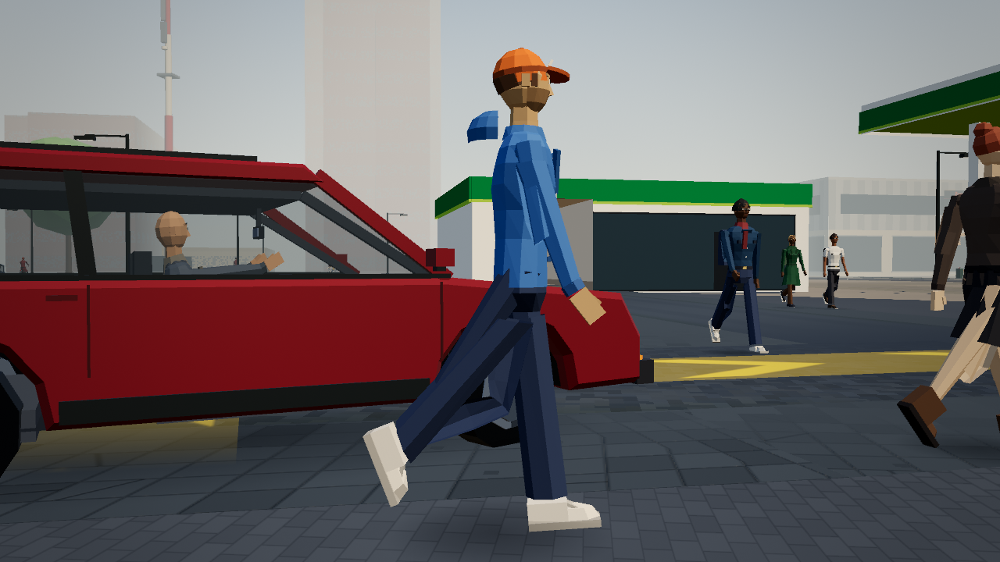
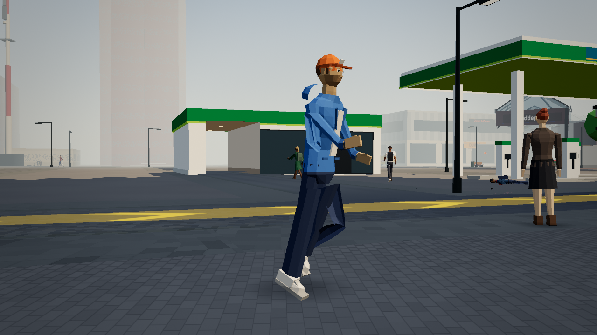
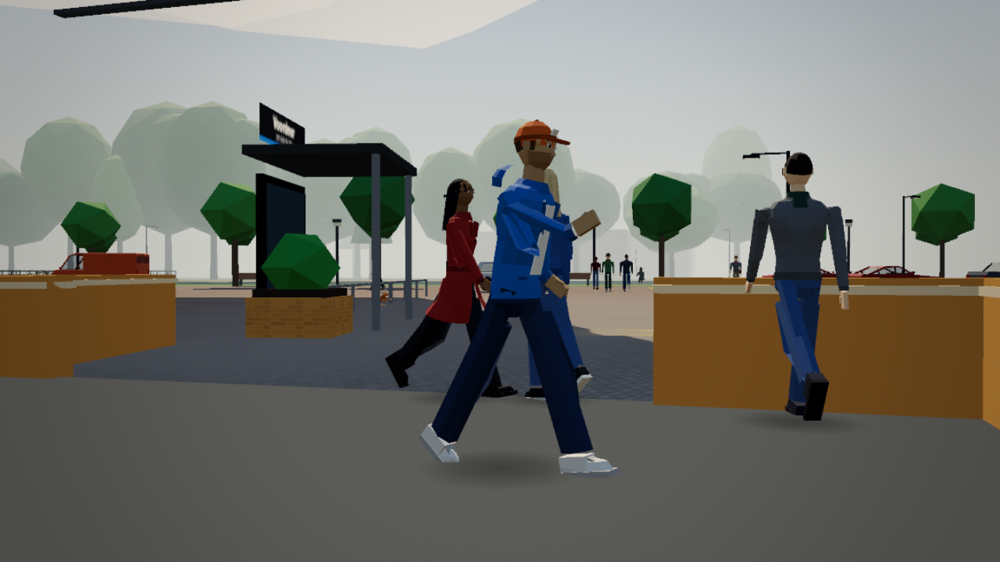

# Mensen en animatie: audit en verbeteringen, 20-11

Een doorlichting van hoe mensen bewegen in het spel (speler, voetgangers, publiek, andere spelers) en wat er vandaag voor is gebouwd (#985, eigenaarsprioriteit AAA bij "Mensen en animatie").
Alles is low-poly en procedureel: één rig van dertien botten (elf lichaamsbotten, het ooglid en de mond) (`models3d_people.js`), geen skeletclips, dus geen nieuwe grote assets. Het uitgangspunt van de verbeteringen is rekenkosten van een paar vermenigvuldigingen per mens, geen extra shaderprogramma's of lichten, en niets over het netwerk erbij.

Wat **gezien** is (Electron, wegwerpprofiel, zie [Beelden](#beelden)): de speler die loopt en rent in zijn eigen model, de bocht, een voetganger die opkijkt, het stilstaan, het publiek. Wat **niet** gezien is, staat onderaan. Alles wat hier "gemeten" heet, is gemeten op een zwaar belaste machine (ver boven 30 ms per beeld in elke run, zie [Frametijd](#frametijd)); het is dus bewijs dat de code draait en niets breekt, geen perf-uitspraak.

## Wat er is (de stand voor vandaag)

| Onderdeel | Waar | Stand |
|---|---|---|
| Loop-, ren-, sluip-cyclus | `models3d_people.js` `animatePersonWalk` (+ `applyCrouch`) | Goed: fase uit snelheid, wandelen en rennen mengen zacht, knie- en elleboogbuiging, romp draait tegen de heupen in, lichte op-en-neer, bukken met been-IK en korte sluipstappen. Zwak: de fase liep los van de stapgeluiden, in een bocht stond de romp recht, het hoofd keek niet vooruit. |
| Idle van iedereen | zelfde functie | Ademen, gewicht verschuiven, langzaam rondkijken (sinus). Zwak: na een minuut staat iedereen nog steeds gewoon te ademen; de rijke clips (horloge, wippen, rondkijken) bestonden alleen voor de wachtfiguur bij een wachtstap (`wachtprops.js`). |
| Zwemmen, klimmen, springen, klauteren | `bewegingrules.js` (`zwemStand`, `klimStand`, `sprongStand`), `scene3d.js` `vaultPose`, `applyAirPose` | Aanwezig en gekoppeld aan de speler en aan de regietaal. Niet opnieuw bekeken vandaag. |
| In- en uitstappen | `seating3d.js` `trackSeat`/`drawTransition` | Aanwezig: de deurkant volgt de plek waar de speler stond, de overgang is zichtbaar en kan met invoer worden overgeslagen. Niet opnieuw bekeken vandaag. |
| Richten, slaan, geraakt worden | `applyAttackPose`, `applyHitReaction`, `ragdoll.js` | Aanwezig (wapenhouding per wapen, slag, schouderschrik, ragdoll bij klap of val). |
| Gesprekken en gebaren | `actoranim.js` (regietaal, `planGestures`, `REACTIONS`) | Rijk in filmpjes: praten gekoppeld aan de regeltijd, luisteraars kijken naar de spreker, schrikken, lachen, schouders, knikken, zwaaien. Voor gewone voetgangers (buiten filmpjes) bestaat dit niet; zij zwaaien alleen op de kade (`greetUntil`) of filmen met een telefoon. |
| Menigten (publiek) | `crowdplan.js`, `crowd.js` (bouwsteen G0b) | Goed gebouwd: pool van acht looks, LOD (volle animatie < 40 m, elk vierde beeld tot 130 m, daarachter niet getekend), reactie op wat voorbijkomt (kijken, juichen, zwaaien). Zwak: iedereen stond hetzelfde stil, geen klappen. |
| Reactie van voetgangers op de speler | `pedestrians.js` | Goed: vluchten bij een wapen of een klap (`flee`, `cower`), staren bij een ongeluk (`gawk`), uitwijken voor het voertuig van de speler (`dodgePlayerVehicle`), de agent en de roadrager hebben eigen toestanden. Zwak: een voetganger die vlak langs je loopt keek nergens naar; een claxon deed niets met hoofden. |
| NPC-routines | `haltefiguren3d.js`, `picnicpeople.js`, `dorpsuitjes.js`, `bikerider.js`, `pedroutes.js` | Wachten bij de halte, picknicken, fietsen (trapbeweging), lopen over routes. Telefoneren (`film`) bestaat als toestand. Zwak: een stilstaande voetganger (bij een kruispunt, in een rij) deed niets na het ademen. |
| Stapgeluid | `sfx/steps.js`, `sfx/foley.js` | Echte opnames per ondergrond, links en rechts met eigen toonhoogte, voetgangers zachter en dofer met afstand. Zwak: de stap kwam uit een eigen afstandsteller (`tickFoot`), niet uit de getekende voet: je zag de linkervoet neerkomen en hoorde de stap een fractie anders. Medespelers waren stil. |
| Samen spelen | `coopfigures3d.js`, `coopextra.js` | Andere spelers worden getekend met dezelfde `animatePersonWalk` (snelheid uit het snapshot, `walkSpeed`), voetgangers bij een gast via compacte vlagbits (groet, feest, wapen, aanval, geraakt, spreekt, tas, ligt: `coopextra.js` `V_*`). Dat is al zuinig en blijft zo. |

## De top-verbeteringen op impact en kosten

Beoordeeld op wat de speler ziet en hoort bij gewoon spelen (veel lopen, veel mensen in beeld), tegen rekenkosten en risico. "Gebouwd" = in de werkbranch, getest, nog niet gemerged.

| # | Verbetering | Impact | Kosten | Stand |
|---|---|---|---|---|
| 1 | Stapgeluid op het hielcontact van de getekende voet (speler en voetgangers), links en rechts uit dezelfde cyclus | hoog (elke stap, de hele sessie) | S | gebouwd |
| 2 | Bochthelling en blik die de bocht vooruitloopt | hoog (elke bocht van de speler en elke voetganger) | S | gebouwd |
| 3 | Voetgangers kijken je even aan als je vlak voor ze langsloopt | midden | S | gebouwd |
| 4 | Medespelers hoorbaar op hun hielcontact (Samen spelen) | midden bij vier spelers | S | gebouwd |
| 5 | Wachtclips (rondkijken, horloge, wippen) voor iedereen die lang stilstaat | midden | S | gebouwd |
| 6 | Publiek klapt en staat niet allemaal hetzelfde stil (telefoon, handen in de zij) | midden bij evenementen en races | S | gebouwd |
| 7 | Hoofden draaien naar een claxon (tot 28 m, 1,6 s) | midden | S | gebouwd |
| 8 | Voetgangers die voor een naderende speler te voet uitwijken (naast het bestaande uitwijken voor voertuigen) | hoog bij drukte | M (raakt de looprichting, dus ook de collisie en `pedsep_test`) | niet gebouwd |
| 9 | Omkijken bij een botsing of een knal (hoofd, daarna romp) | midden | M (nodig: een "hoorbare gebeurtenis"-lijst per frame) | niet gebouwd |
| 10 | Praatgroepjes van voetgangers (twee tot drie mensen die naar elkaar kijken en gebaren) | hoog voor de sfeer in de binnenstad | M (plaatsing in `pedroutes.js`, anders dan de regietaal) | niet gebouwd |
| 11 | Telefoneren en rondkijken bij een rij of kruispunt (gebruik de `film`- en `phone`-houdingen zonder wapen) | midden | M | niet gebouwd |
| 12 | Een eigen opstaan- en neerzittenanimatie op een bankje of stoel | midden | M (seating3d) | niet gebouwd |
| 13 | Voetcontact met de grond via IK op trap en helling (geen zwevende voet) | midden, alleen zichtbaar bij dicht bij | L | niet gebouwd |
| 14 | Een eigen sprint-uitputting en hijgen als animatie bij leeg uithoudingsvermogen | laag | S | niet gebouwd |

De volgorde van bouwen was 1 tot 7: ze delen hetzelfde punt (`animatePersonWalk`), vragen geen asset en raken de looprichting of collisie niet. Nummer 8 en 9 zijn de volgende stappen met de beste verhouding, maar raken `pedestrians.js` (de verwarring met `pedsep_test` en het uitwijken voor voertuigen) en horen na de release van 13:00.

## Wat er gebouwd is

Alles in `game/js/gait.js` (puur, geen imports) met `idleclips.js` (de wachtclips, puur) en een paar regels in de bestaande plekken.

1. **Voetcontact** (`footContact`): uit de loopfase die `animatePersonWalk` al heeft. Links raakt de grond bij fase pi/2, rechts bij 3 pi/2. Elk frame is hoogstens 0,1 s, dus hooguit één contact. `animatePersonWalk` houdt `ud.footN` en `ud.footSide` bij; `scene3d.js` geeft ze door aan de speler en de voetgangers (`shareFeet`: `footN`, `footSide`, `footT`), en `sfx/foley.js` speelt de stap bij een nieuw contact in plaats van bij de eigen afstandsteller. Valt de bron weg (geen mesh getekend, een voetganger buiten beeld, een gestokt frame), dan neemt `tickFoot` het over. Met de afstandsteller van vroeger klopt het tempo precies (testen op `strideFor`), maar de voet klopte alleen op gemiddelde; nu klopt hij op het moment zelf.
2. **Bochthelling en blik vooruit** (`turnLean`): de verandering van de heading per seconde (alleen tijdens lopen, zacht aan vanaf 0,4 m/s) laat de romp tot 0,14 rad (ruim 8 graden) in de bocht hellen, en laat de blik tot 0,3 rad de bocht vooruitlopen. Beperkt tot 6 rad/s (een muis die snel draait geeft geen schommelende romp), en wie op de plek draait helt niet.
3. **Blik naar de speler** (`glanceAt`, `gazeToward`, `glanceOn`): een voetganger binnen 9 m, met de speler voor zich (binnen 120 graden), kijkt ongeveer de helft van de tijd, in glimpen van ~1,5 s, per mens anders gefaseerd. Niet met iets in de hand (wapen, last, pose).
4. **Claxon**: `glanceAt` kijkt naar `player.inVehicle.horn` en trekt dan elke blik binnen 28 m ~1,6 s naar het voertuig.
5. **Wachtclips voor iedereen** (`fidgetAt`, `idleclips.js`): na 5 tot 10 s stilstaan een clip van 4 s (rondkijken, horloge, wippen), dan 7 s rust, en zo door; gewogen als overlay op de rustpose (verschillen met de neutrale stand, nul aan begin en einde), niet bij bukken, paraplu, lijn of pose. De clips staan sinds vandaag in `idleclips.js`; `wachtprops.js` voert ze nog steeds uit en exporteert `idlePose` zoals voorheen.
6. **Publiek**: `clap` (nieuwe acteer-anim, reactie `klap`: de onderarmen voor de borst, de handen komen om de 0,35 s bij elkaar) en `idleFor`: een deel van het wachtende publiek staat met een telefoon of de handen in de zij. De regietaal (`cutscript.js`) kent `clap` nu ook.
7. **Medespelers hoorbaar**: `coopfigures3d.js` geeft het hielcontact van elke figuur door; `sfx/foley.js` speelt de stap als een voetganger (tot 20 m, zachter en dofer met afstand).

Tests: `scripts/gait_test.mjs` (puur: contacten per cyclus, wisselen, afstand tussen contacten tegen `strideFor`, wrap over 2 pi, bocht, blik, glimpen, claxon, wachtclips, de koppeling in de code), `scripts/gait_anim_test.mjs` (op een echt model: contacten, bochthelling links en rechts, de blik, de wachtclips zonder NaN en zonder sprongen) en uitbreidingen in `scripts/crowd_test.mjs`.
Beeldscript: `scripts/qa/mensen_beeld.mjs` met `mensen_beeld.page.js`.

## Samen spelen

Geen nieuw veld in de pose of het snapshot: alles volgt uit positie, hoek en snelheid, of is lokaal beeld (zie `docs/COOP-GAST.md`, "Loopcyclus, bocht en blik"). Een gast tekent de figuur van een andere speler met dezelfde `animatePersonWalk` en ziet dus dezelfde bochthelling en hoofddraai; de loopfase zelf loopt per apparaat vrij (alleen de cadans volgt de snelheid), net als voorheen. De blik van voetgangers naar de speler en de wachtclips zijn idle-kleur per apparaat. De stappen van een medespeler zijn nu hoorbaar, lokaal en zonder bericht. Het publiek wordt lokaal opgebouwd uit spec en seed. Test voor "gasten zien dezelfde animatie": de pure functies zijn deterministisch (`gait_test.mjs`), en de gastweergave gebruikt dezelfde functie; er is geen testbankstap met twee instanties voor dit onderdeel (niet gedaan).

## Beelden

Gezien in Electron (`scripts/qa/mensen_beeld.mjs`, wegwerpprofiel; de speler wordt kinematisch verplaatst, de camera staat aan de zijkant):

-  De wandelcyclus na de wijziging: voet van de ene kant voor, andere voet achter, de arm zwaait mee, het hoofd kijkt recht.
-  en : de renpose na en voor de wijziging. Verschillende plekken (de run begint naast de dichtstbijzijnde voetganger); het verschil in romphelling is bij 5,5 m/s en een bocht van 0,8 rad/s klein, zoals bedoeld (maximaal 8 graden). Niet pixel voor pixel vergelijkbaar.
- Meer opnames per onderdeel (voetganger die opkijkt, de speler die op zijn horloge kijkt, het publiek in wachtstand en bij een passage): zie de lijst hieronder voor wat daadwerkelijk is gezien.

## De modellen van Tammo en Tessa: gaten en clipping

Extra opdracht van de eigenaar (bekend: de muts van Tammo heeft geen binnenkant, het haar van Tessa steekt in haar hoofd). Aanpak: close-ups uit zeven hoeken (voor, schuin, zij, achter, schuin-achter, laag, hoog) in stand, tijdens het lopen en zittend, in Electron (`scripts/qa/mensen_beeld.mjs --page=modellen_beeld.page.js`, beelden in `docs/beeld-20-11/mensen/`), plus een meting op de geometrie (hoekpunten van het haar binnen de kop-ellipsoide). Alleen modelcode (`models3d_people.js`): geen assets, geen extra draw calls.

| Bevinding | Oorzaak | Fix | Test |
|---|---|---|---|
| Muts, pet, beanie en flatcap zijn van onderaf doorzichtig | `hairCap` bouwt één schil met alleen een buitenkant | tweede wand eronder met naar binnen gekeerde vlakken (`innerColor`), die tot nul dunner wordt aan de rand zodat de schil op het hoofd blijft sluiten (circa zeventig driehoeken meer per pet) | `scripts/model_dicht_test.mjs` (naar binnen gekeerde driehoeken boven het voorhoofd, voor Tammo, pet, beanie en flatcap) |
| Het lange haar van Tessa heeft zwarte punten in het gezicht aan de slapen | de binnenwand van `hairCurtain` (T = 16 mm naar binnen) zakt aan de openingsranden tot 10 % in de kop (38 hoekpunten bij q = 0,90 van de ellipsoide) | `outsideHead`: de binnenwand (en de buitenwand iets verder) wordt zijwaarts uit de kop geduwd (1,02 en 1,06 maal de kop) | zelfde test: geen haarhoekpunten meer dieper dan 7 mm in de kop, voor Tessa en 24 andere lange haren |
| Een blauwe vin zweeft naast de nek van Tammo (ook in de loopbeelden) | de capuchon van jas en hoodie is een open halve kom zonder binnenwand | `hoodBowl`: een tweede, iets kleinere wand met naar binnen gekeerde vlakken (voering) | `model_dicht_test.mjs` (buiten- en binnenwand achter de nek) |

Voor-beelden (de build van vandaag, met de loop- en blikwijzigingen maar zonder deze fixes): [Tammo schuin](beeld-20-11/mensen/voor-tammo-stand-schuin.png) (de blauwe vin links van de nek, de donkere baardvlek), [Tammo hoog](beeld-20-11/mensen/voor-tammo-stand-hoog.png), [Tammo laag](beeld-20-11/mensen/voor-tammo-stand-laag.png), [Tessa schuin](beeld-20-11/mensen/voor-tessa-stand-schuin.png) en [Tessa voor](beeld-20-11/mensen/voor-tessa-stand-voor.png) (zwarte punten van het haar over slaap en voorhoofd).

Gezien maar **niet** veranderd: de spitse huidpunten boven het voorhoofd van Tessa (het hoofd steekt op de haarlijn door de schil van `hairCap`, een gevolg van de lage resolutie en de helling van 0,3 rad; het haar zelf is dicht), de plek van de capuchon (5 cm achter de nek, niet aan de kraag vast), de donkere baardvlek van Tammo (stoppels als één vlak) en de zijbakkebaarden als platte blokjes. **Niet bekeken:** kraag, oren, bril en handen uit alle hoeken, de zitpose in een echte auto (de zitopname hier staat los van een voertuig), cutscene-camerastanden uit de verhaalscripts, en andere personages dan Tammo en Tessa (de fixes gelden voor alle mutsen, lange haren en hoodies, maar zijn alleen bij deze twee in beeld gezien).

## Frametijd

Elke run draaide op een machine met bijna geen vrij geheugen en een volle CPU (de coördinator meldde < 2 GB vrij, 97 % CPU), met een software-GPU (`--in-process-gpu`) en andere Electron-instanties van andere sessies. De gemeten frametijden (20 tot 100 ms, voor en na) liggen daarom ver boven de perf-norm van 33,5 ms en zeggen niets over de wijziging: ze verschillen niet meer tussen voor en na dan tussen twee runs van dezelfde build. **Vervuilde meting, niet bruikbaar als perf-bewijs.** Wat wel bekend is: de toegevoegde rekenkosten per mens zijn een `footContact` (twee vergelijkingen), een `turnLean` (een paar vermenigvuldigingen), twee `approachTo` en één `wrapPi`; voor voetgangers binnen 9 m één `gazeToward` (een `atan2` en een afstandskwadraat) en `glanceOn` (twee sinussen) alleen als de speler voor hen staat; de wachtclip kost een `idlePose` per stilstaande mens gedurende vier van elke elf seconden. Er is geen extra shaderprogramma, licht, draw call of geometrie, en geen nieuwe allocatie per frame (de pose en het tijdsvak worden hergebruikt). Een nette meting hoort bij een stille machine (zie de perf-trendmeting van de coördinator).

## Gezien en niet gezien

Gezien: de wandel- en rencyclus in beeld, de speler die staat (geen NaN, geen scheve romp), de run zonder fouten in de console van het script. Zie hierboven voor de beelden die zijn opgeslagen.
Niet gezien, nog niet bekeken: een scherpe bocht van een rennende voetganger; de blik van een voetganger in beeld bij een echte passage (er is een glimp gemeten, `blikFrames`, maar de hoek is niet beoordeeld); de claxon in beeld; het geluid van de stappen op de getekende voet (alleen de code en de pure test: niet beluisterd); medespelers lopen horen (niet getest met twee instanties); zwemmen, klimmen, in- en uitstappen zijn vandaag niet opnieuw bekeken; fietsers, picknickers en haltefiguren zijn niet beoordeeld.

### Na-beelden van de modelfixes (gezien)

[Tammo schuin, na](beeld-20-11/mensen/na-tammo-stand-schuin.png): de capuchon heeft nu een donkere binnenwand (voering) en is geen losse vin meer; de pet is ongewijzigd goed. [Tessa voor, na](beeld-20-11/mensen/na-tessa-stand-voor.png): **de zwarte punten over voorhoofd en slapen zijn er nog**; de slaapfix is in beeld niet te onderscheiden en dit probleem is niet opgelost. Waarschijnlijk komen ze uit de rand van `hairCap` (front van de haarschil, 10 segmenten, helling 0,3 rad) en niet uit `hairCurtain`; niet verder onderzocht. Open voor een vervolgronde.

### Tessa: haarschil gerepareerd (gezien)

Oorzaak van de zwarte punten: `hairCap` kantelde de schil (0,3 rad) om het midden van het hoofd en zette de rand op 0,99 van de kop; daardoor zakte de voorkant van de schil in het voorhoofd en sneden de zigzagranden door de huid. Fix: rand op 1,03, na het kantelen elk punt radiaal uit de kop-ellips duwen, 14 segmenten en een iets ruimere schil (1,06 kort, 1,08 lang). Test: `model_dicht_test.mjs` (geen haarhoekpunten dieper dan 3 procent in de kop). Na-beelden: [Tessa voor](beeld-20-11/mensen/na2-tessa-stand-voor.png), [schuin](beeld-20-11/mensen/na2-tessa-stand-schuin.png), [lopend van onderaf](beeld-20-11/mensen/na2-tessa-loop-schuin.png), [Tammo schuin](beeld-20-11/mensen/na2-tammo-stand-schuin.png): geen zwarte wiggen of huidpunten meer; de pony valt nu over de wenkbrauwen (de haarlijn ligt iets lager). Zitpose en achterkant niet apart beoordeeld.
