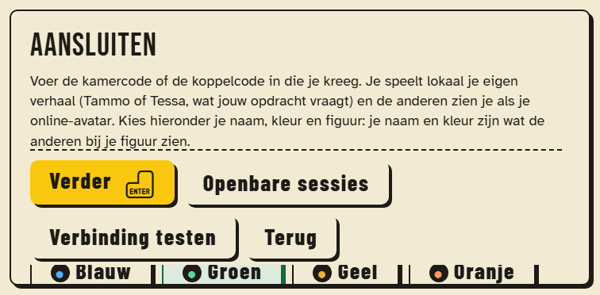
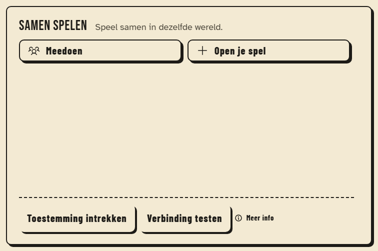
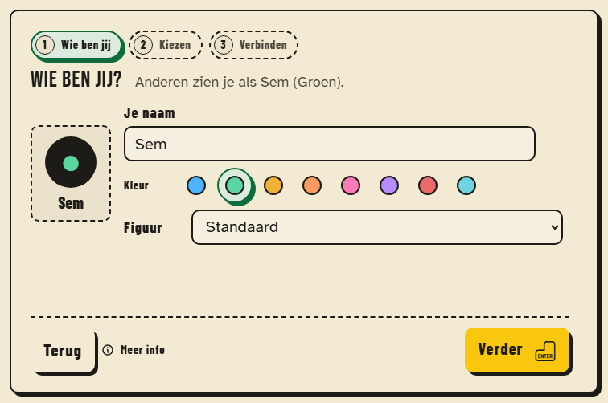
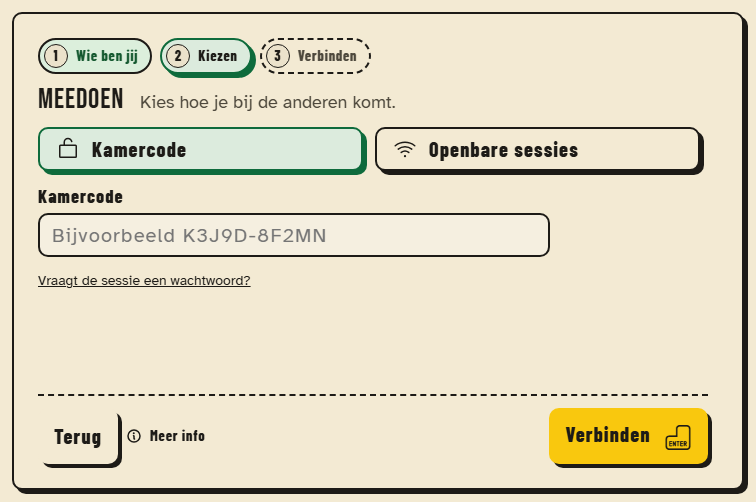
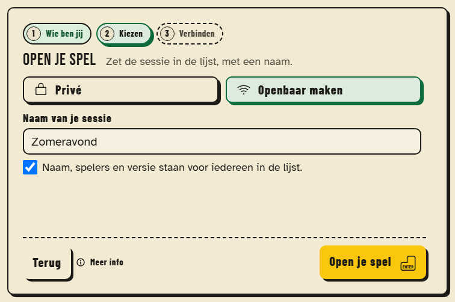
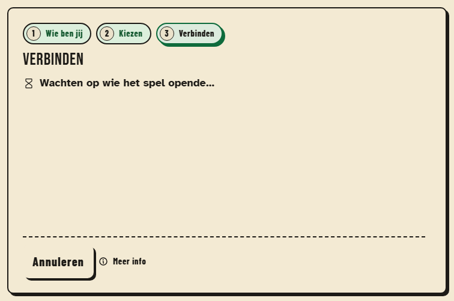
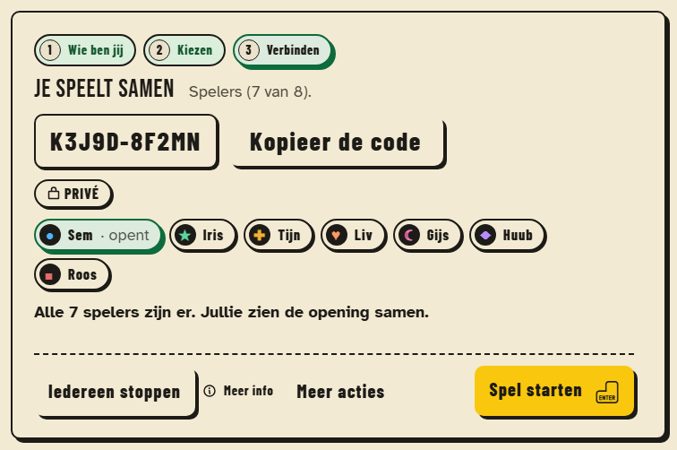
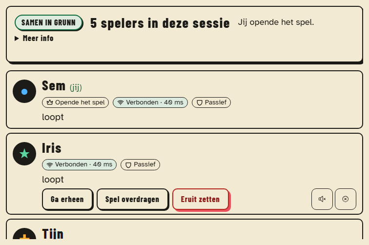

# Samen spelen: de flow als wizard (#1011, 22-11)

> Canonieke regels: [.specs-fire/standards/multiplayer.md](../.specs-fire/standards/multiplayer.md) en [ui-taal.md](../.specs-fire/standards/ui-taal.md). Dit document is het ontwerp en de meting van de herziene flow; bij tegenspraak wint de spec. Vervolg op [SPELERSMENU-UX-21-11.md](SPELERSMENU-UX-21-11.md).

Eigenaar, na het zien van Spel > Samen spelen > Sessie > Aansluiten: "Ik vind dit nog niet echt een overzichtelijke UI en stappen."
Opdracht: de flow een duidelijke stap-voor-stap-wizard maken in DS3, zonder het netwerkprotocol of de beveiligingsregels te wijzigen.

## 1. Voor: wat de eigenaar zag



Gemeten op 1280x720 met ui-schaal 1,5 (de menustage is dan 1280x720 ontwerp-px): het formulier is 1169 px hoog in een vak van 344 px, dus het scrolt binnen een kader.

| Punt van de eigenaar | Oorzaak |
| --- | --- |
| Eén lang scrollend formulier, geen stap 1, 2 en 3 | `lobby.js` `gast-typt` zette uitleg, profiel, kleuren, wachtwoord, kamercode en vier knoppen op één scherm |
| De knoppenbalk overlapt de naamchips | de balk was `position: sticky` over de inhoud heen (`pausemenu.css`) |
| Standaard scrollbalk | `.pm-samen-inner` is `overflow-y: auto` |
| Aansluiten tegenover Zelf hosten niet zichtbaar | de keuze zat in een oud beginscherm of in de hub, niet op het scherm zelf |
| Lange, juridische uitleg | zes alinea's per scherm |
| Verbinding testen en Openbare sessies lijken gelijkwaardig aan Verder | alle vier even groot en zonder rangorde |

## 2. De stapkaart

```
                     Samen spelen (Spel > Samen spelen > Sessie)
 ┌──────────────────────────────────────────────────────────────────────────────────┐
 │ Stap 0   KEUZE            [ Meedoen ]            [ Open je spel ]                │
 │          (lopende sessie: statuskaart "Je speelt samen" met spelers, Verlaat sessie)│
 └───────────────┬──────────────────────────────────────┬───────────────────────────┘
                 │ Meedoen (gast)                       │ Open je spel (opener)
                 ▼                                      ▼
 Stap 1   WIE BEN JIJ?   naam + kleur + figuur + live voorbeeld   [Terug] [Verder  ⏎]
                 │ (één keer per sessie van de pagina; de naam staat al in Instellingen)
                 ▼                                      ▼
 Stap 2   KIEZEN                                        KIEZEN
          [Kamercode] [Openbare sessies] [Vrienden]     [Privé (standaard)] [Openbaar maken]
          code (+ wachtwoord alleen op verzoek)         wachtwoord (niet verplicht)
          [Terug] [Verbinden  ⏎]                        openbaar: sessienaam + vinkje
                 │      └─ lijst: rijen met naam, spelers, versie, niveau     [Terug] [Open je spel ⏎]
                 │         (Terug of Esc: terug naar stap 2)
                 ▼                                      ▼
 Stap 3   VERBINDEN                                     VERBINDEN
          "Verbinden…" → "Wachten op wie het spel       "Je kamercode wordt gemaakt…"
           opende…" → "Verbonden"                        code + [Kopieer de code], Privé/Openbaar,
          [Terug] [Verbinding testen]                    spelers, [Spel starten ⏎]
          fout: terug naar stap 2 met één korte melding  (wachtkamer; daarna loopt de sessie)
```

Boven elke stap 1 tot 3 staat de indicator `1 Wie ben jij · 2 Kiezen · 3 Verbinden`. Een uitgevoerde stap is groen, de huidige heeft een harde rand, een komende stap is gestippeld.

## 3. Wat elke stap doet

| Stap | Inhoud | Hoofdactie (rechtsonder, geel, Enter) | Terug (B/Esc) |
| --- | --- | --- | --- |
| 0 Keuze | twee grote kaarten met icoon en één regel; statuskaart bij een lopende sessie | de kaarten zelf; de focus begint op Meedoen | het menu (Esc sluit het onderdeel) |
| 1 Wie ben jij | live voorbeeld (vorm in jouw kleur plus naam), naam, één rij kleurbolletjes (de naam alleen bij focus of aanwijzen), figuur als keuzelijst (alleen bij meedoen) | Verder | naar stap 0 |
| 2 Kiezen (gast) | Kamercode, Openbare sessies, Vrienden (alleen met favorieten) naast elkaar; bij Kamercode het codeveld en de link Vraagt de sessie een wachtwoord? | Verbinden | naar stap 1 |
| 2 Kiezen (opener) | Privé of Openbaar maken; wachtwoord (niet verplicht); bij Openbaar de sessienaam en het vinkje | Open je spel | naar stap 1 |
| 2 de lijst | rijen met naam, spelers, versie en niveau; zoeken en filters; alleen deze lijst en de testuitslag mogen scrollen | geen (de rijen zijn de actie) | naar stap 2 |
| 3 Verbinden | één voortgangsregel; de kamercode groot met Kopieer de code; spelerschips | Spel starten (met minstens twee spelers) | Annuleren of Stoppen (Esc sluit hier alleen het menu) |

De voetzone is vast: Terug of Stoppen links, Meer info, de rest achter Meer acties, en rechts de hoofdactie. Secundaire acties zijn grijs en omlijnd; Verbinding testen en Openbare sessies zijn nooit de hoofdactie. Wat niet past, staat achter Meer acties (een volle voet houdt één secundaire knop).

Tekstdieet: de korte regel boven de inhoud is hoogstens 70 tekens (`HINT_MAX`); de volledige tekst van `lobby.js` blijft ongewijzigd en staat achter Meer info. Alleen de uitslag van de test, een foutuitleg en de lijst met sessies tonen hun regels zelf.

## 4. Na

| Stap 0 | Stap 1 |
| --- | --- |
|  |  |

| Stap 2, meedoen | Stap 2, opener (openbaar) |
| --- | --- |
|  |  |

| Stap 3, verbinden | Stap 3, wachtkamer |
| --- | --- |
|  |  |



Alle beelden komen uit de headless renderproef met de echte `lobbyui.js` en de echte CSS (`node scripts/ui/multiplayerflow_meet.mjs --shots`). Het zijn geen beelden uit het draaiende spel.

## 5. Meting

`node scripts/ui/multiplayerflow_meet.mjs` bouwt het pauzemenu-vak na (stage met `--mz`, `.pm-samen`, `.pm-samen-inner`), mount de echte lobby met nephooks (geen netwerk) en meet 22 schermen op 1280x720 en 1920x1080, elk met ui-schaal 1 en 1,5: 88 metingen. Per meting:

- geen scrollbalk in het vak en geen afgekapte of weggeduwde inhoud (uitzondering: de lijst met openbare sessies en de uitslag van de test);
- geen overlap tussen de blokken, de knoppen in de voet en de kaartjes; alles binnen het vak;
- de voet staat onder de inhoud en de hoofdactie staat rechts en is geel;
- de korte regel is hoogstens 70 tekens, geen alinea's langer dan 110 tekens in beeld, geen IP-adres of directe code;
- de indicator wijst de juiste stap aan.

Resultaat: 0 overtredingen. De menustage is op 1280x720 met ui-schaal 1,5 slechts 1280x720 ontwerp-px, en het vak is daar ruim 470 px hoog. Daarom verdwijnt de bladkop "Spel" zolang de wizard open staat (de tabrij zegt waar je bent), krijgt het vak minder opvulling en gaan de regel onder de kaartnaam en de grootte van de knoppen mee met de hoogte van het vak (een `@container`-regel op het vak, niet op het venster: de stage wordt ingezoomd).

Zichtbare tekens per stap (1280x720, ui-schaal 1,5):

| Scherm | Stap | Korte regel | Tekens in beeld |
| --- | --- | --- | --- |
| Keuze | 0 | 31 | 182 |
| Wie ben jij (gast, opener) | 1 | 32 | 236, 158 |
| Kamercode (ook met wachtwoord of fout) | 2 | 32 | 202, 194, 274 |
| Lijst met openbare sessies | 2 | 34 | 494 (lijst) |
| Toestemming | 2 | 56 | 166 |
| Privé, Openbaar, Openbaar zonder vinkje | 2 | 27 en 40 | 158, 245, 301 |
| Verbinden (kort, wachten, lang) | 3 | 0 | 68, 89, 90 |
| Wachten op spelers, wachtkamer | 3 | 36 en 18 | 163, 232 |

Pure tests: `scripts/multiplayerwizard_test.mjs` (de stapmachine: volgorde, terug, validatie, foutpaden, privacyregels, de HTML per stap) en `scripts/playercards_test.mjs` (de kaartjes).

## 6. Privacy en veiligheid (constitutie 10)

| Regel | Hoe de wizard het afdwingt |
| --- | --- |
| Een IP-adres is nooit zichtbaar | het kamercodeveld toont een directe code (`GDE2-...`) nooit; het voorbeeld in het veld is een kamercode; de meting en de tests falen bij een IP-adres of `GDE2-` in beeld |
| Sessies zijn standaard privé | de wizard begint op Privé; terug naar Privé wist het vinkje, zodat een tweede keer openbaar opnieuw om bevestiging vraagt |
| Openbaar alleen na uitdrukkelijke bevestiging | Open je spel is geblokkeerd tot het vinkje staat en de sessienaam er is; de sessie gaat pas in de lijst als de kamercode er is (`maakOpenbaar` in `lobbyui.js`); de IP-route is nooit openbaar |
| Geen echte persoonsnamen in sessienamen | dezelfde filter als voorheen (`schoonNaam`, lijst verboden woorden); een geweigerde naam komt met de uitleg van het filter terug |
| De host kan kicken | Eruit zetten staat op het kaartje van elke andere speler, met bevestiging; alleen voor wie het spel opende, nooit bij jezelf |
| Het spel is 18+, geen tekstchat | niets veranderd; Dempen en Blokkeren zijn alleen voor jou (in het geheugen, #1159) |

Niet veranderd: `net/*`, `coopnet.js`, het protocol, de toestemming (`onlineconsentui.js`, de eerste-keer-kaart met naam en akkoord), `joingate`, de openbare lijst en de verbindingsproef. De wizard gebruikt dezelfde `data-act`-namen en dezelfde gebeurtenissen van `lobby.js` als voorheen.

## 7. Samen spelen: wie ziet wat

Dit is de Samen-UI zelf; het is een weergave en er is geen voortgang, beloning of netwerkbericht aan toegevoegd.

- Wie het spel opent (de wereld is van hem): ziet de wizard met Open je spel, de wachtkamer met de kamercode, Privé of Openbaar, wachtwoord en Spel starten, en op het tabblad Spelers Eruit zetten en Spel overdragen bij de anderen.
- Een gast: ziet Meedoen, Kamercode, Openbare sessies en Vrienden, daarna de wachtkamer met de spelers en Spel starten (dat vraagt de start aan wie het spel opende). Een gast ziet geen Eruit zetten en geen Spel overdragen.
- Iedereen: dezelfde lijst spelers (naam, kleur, status); Dempen en Blokkeren werken lokaal.
- Valt iemand weg: het kaartje staat gestippeld met Verbinding weg; de wachtkamer blokkeert Spel starten zoals voorheen. Sluit iemand later aan: de lijst ververst zich zoals voorheen.
- Wie een sessie heeft: de wizard toont stap 0 niet meer, maar de statuskaart "Je speelt samen".
- Dekking: `multiplayerwizard_test`, `playercards_test`, `multiplayerflow_meet` en de bestaande `lobby_test`, `lobbyui_*`, `coopui_test`, `samenhub_test`.

## 8. Wat veranderd is in de code

- `game/js/multiplayerwizard.js`: de stapmachine (puur): stappen, indicator, Terug, validatie, voortgangsregel, voetvolgorde, kaartregels.
- `game/js/multiplayerwizardui.js`: de HTML van elk scherm (zonder DOM, dus meetbaar).
- `game/js/lobbyui.js`: `mountLobby(..., { wizard: true })` tekent de wizard; zonder die optie (wachtscherm in het spel, tests) blijft alles zoals het was. Nieuwe acties: `wie-verder`, `wie-terug`, `wijze-*`, `ww-open`, `vrienden`, `host-open`; `view.wizTerug()` voor Esc en B.
- `game/js/samenpanel.js`: het paneel opent de wizard in plaats van de hub (#527). `samenhub.js` en `samenhubui.js` blijven staan voor hun eigen test.
- `game/js/playercards.js` en `game/js/coopspelersui.js`: de kaartjes van het tabblad Spelers.
- `game/js/samenspelen.css`: de stijl (alleen DS3-tokens).
- `scripts/ui/multiplayerflow_meet.mjs`: de renderproef (headless Chrome met een eigen profiel; zonder Chrome slaat hij netjes over).

## 9. Niet gedaan en nog te bekijken

- Niet in het echte spel bekeken: de beelden komen uit een nagebouwd menuvak met de echte code en CSS. Zichtbaar anders kan: de lettergrootte van de menutekst op een echt scherm, de focusring met een controller, de animatie bij het wisselen van stap.
- Niet met meerdere instanties gespeeld: de echte verbinding (kamercode, de lijst, wachtwoord, openbaar maken, Spel starten) is hier alleen via gebeurtenissen en nephooks doorlopen, niet met twee echte spelers.
- Vrienden is een snelkoppeling naar de lijst met het filter Favorieten (de sterren van #464); er is geen echte vriendenlijst.
- De oude hub (`samenhubui.js`) wordt door het paneel niet meer gebruikt; opruimen kan na een besluit.
- Het tabblad Spelers scrolt bij vijf of meer spelers (het is een lijst); de kaartjes zijn niet verder ingekrompen.
- `lobbyui_serverlijst_test` is wisselvallig (ook op `main`): hij faalt soms op de stap `host-maakt-code` in plaats van `host-wacht`. Niet door deze wijziging.
- `ds3_ratel_test` meldt een stijging van "lang" in `hud_panel.css`; dat bestand is niet aangeraakt.
